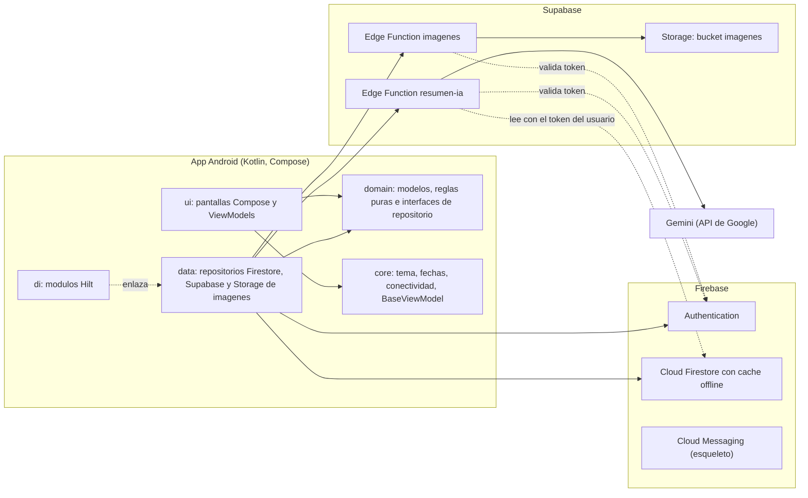
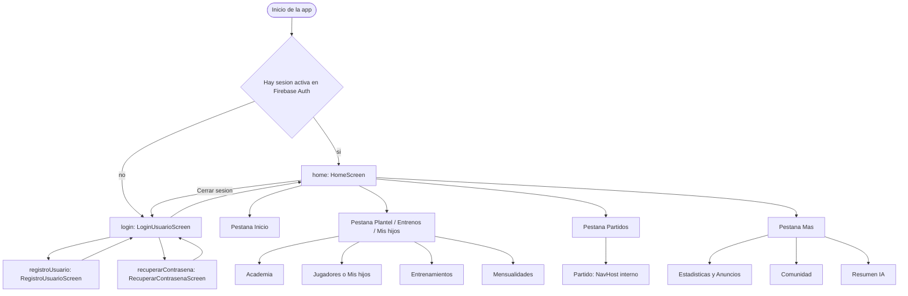
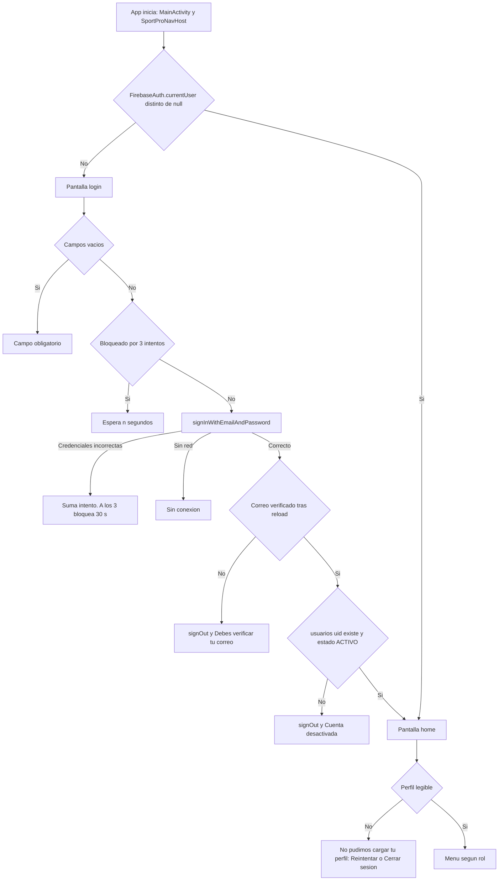
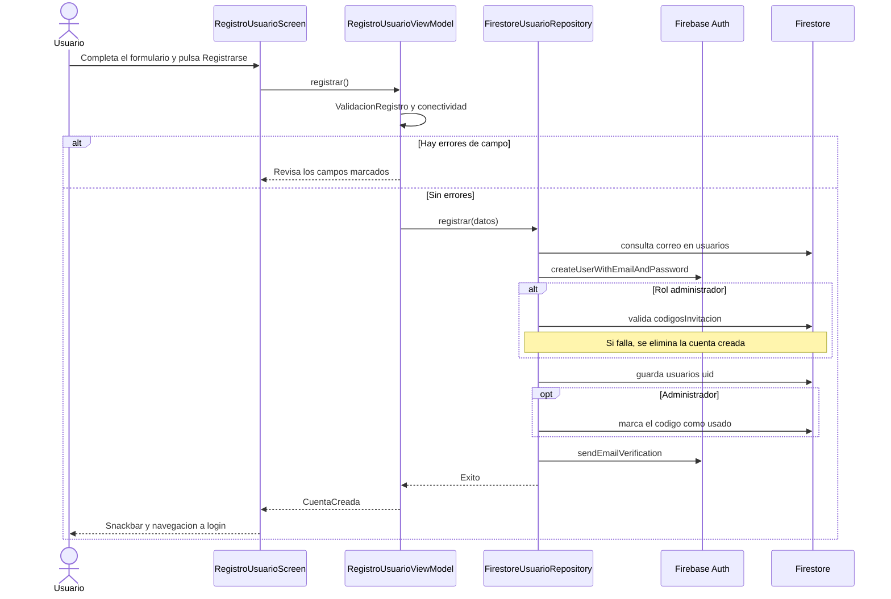
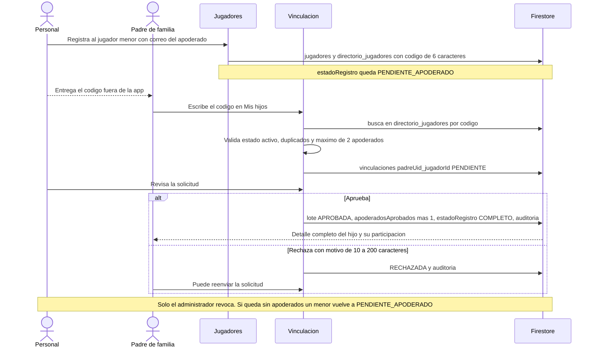
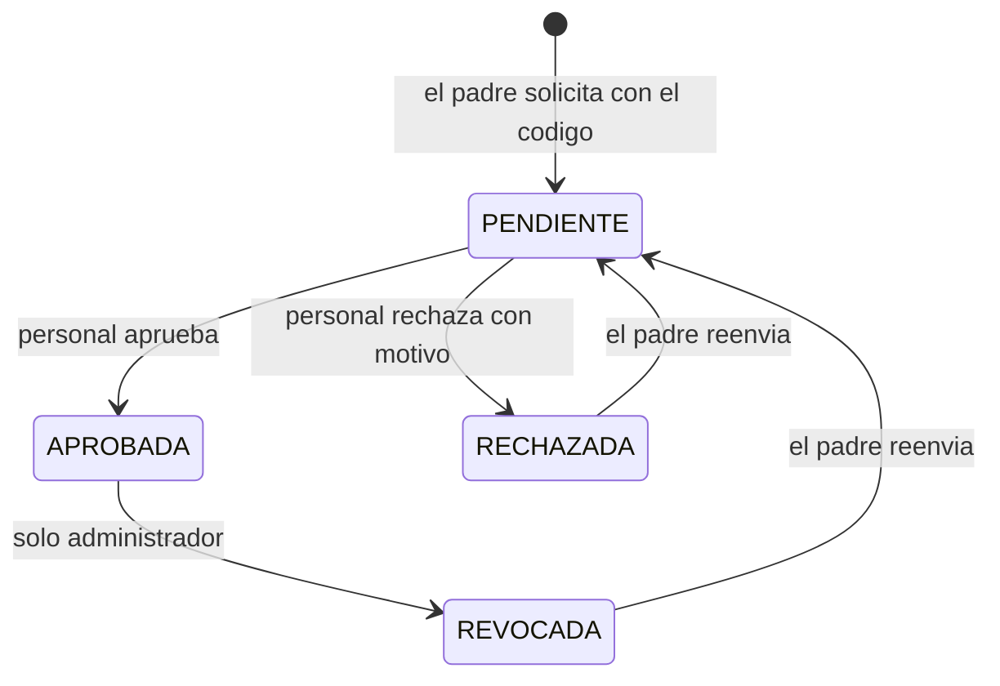
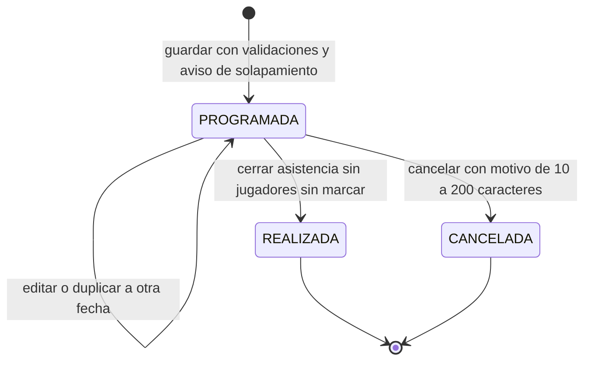
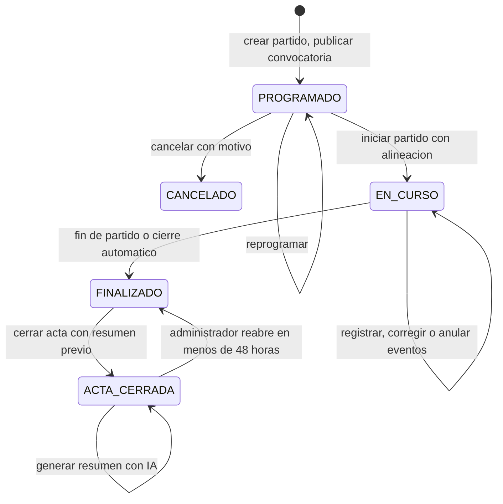
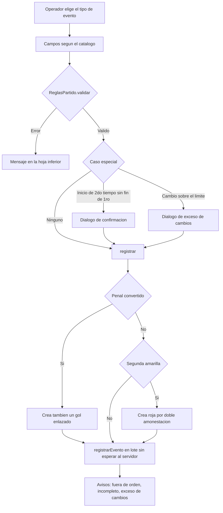
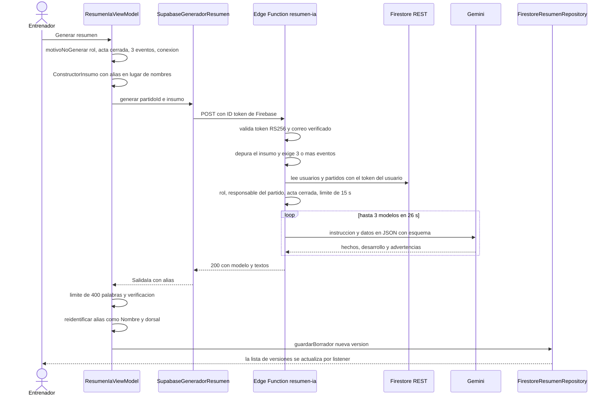

# SportPro — Documentación técnica

| | |
|---|---|
| **Rama documentada** | `feature/US-023-resumen-ia` (la más reciente; contiene US-022 y US-021) |
| **Commit** | `77b2163` (6 de noviembre de 2026) |
| **Fecha del documento** | 7 de noviembre de 2026 |
| **Aplicación** | App móvil Android de gestión de academias y equipos de fútbol (curso Desarrollo de Aplicaciones Móviles, ESAN) |
| **Tamaño del código** | 219 archivos Kotlin en `app/src/main`, 14 archivos de pruebas unitarias, 2 Edge Functions de Supabase, un archivo de reglas de Firestore |

> **Esta documentación describe el estado del commit `77b2163`.** Después se integraron en `main` las mejoras de Mensualidades (selector de jugador en Registrar pago, que corrige el hallazgo 1 de 4.10 y el defecto de 3.23) y se desarrollaron **US-024 y US-025** (revisión, aprobación y evaluación del resumen; ver `docs/diseno-integracion-ia.md`, sección 14), que en este texto figuran como pendientes. Hay que actualizar esos apartados al integrar esas ramas.

## Alcance y método

Este documento describe cómo funciona la aplicación por dentro: arquitectura, pantallas, validaciones, flujo de los datos y comportamiento ante errores.

- **Cómo se elaboró.** Se leyó el código fuente completo de cada módulo, las reglas de seguridad (`firestore.rules`), las funciones de Supabase y los tests. Los mensajes de error y los límites numéricos se citan **tal como aparecen en el código**. Se comprobaron contra el código las afirmaciones más importantes y las que resultaron sorprendentes.
- **Lo que no se hizo.** No se ejecutó la aplicación ni se compiló la interfaz en el entorno de documentación. Lo que dice el documento sobre el comportamiento en ejecución se deduce de leer el código; cuando una conclusión es una inferencia y no una comprobación, se indica con la expresión *por lectura del código*. Lo que no se pudo verificar se marca como *no verificado*.
- **Rutas.** Todas las rutas de archivo son relativas a la raíz del repositorio. Para abreviar, en los textos se usa `…/` en lugar de `app/src/main/java/com/esan/sportpro/`. En las tablas de la sección 2 se escribe la ruta completa.
- **Historias de usuario.** Las 30 historias (`US-001` a `US-030`) están como *issues* del repositorio en GitHub. El estado de cada una se resume en la sección 1.10.

---

# 1. Visión general de la arquitectura

## 1.1 Cómo funciona la aplicación, de principio a fin

SportPro es una aplicación **Android nativa** escrita en **Kotlin** con **Jetpack Compose** (interfaz declarativa, Material 3). Sigue el patrón **MVVM**: cada pantalla es una función `@Composable` que observa el estado que publica su **ViewModel** y le notifica las acciones del usuario. El ViewModel aplica las reglas de negocio y habla con la capa de datos a través de **interfaces de repositorio**; la implementación de cada repositorio usa Firebase o Supabase.

El recorrido típico de una acción es el siguiente:

1. El usuario toca algo en una pantalla (`ui/...Screen.kt`).
2. La pantalla llama a un método del ViewModel (`ui/...ViewModel.kt`).
3. El ViewModel valida con **funciones puras** de `domain/` (sin Android ni Firebase, por eso se pueden probar con pruebas unitarias) y actualiza su estado (`StateFlow`).
4. Si hay que persistir o leer datos, llama al repositorio. La interfaz está en `domain/` y la implementación en `data/` (`Firestore...Repository`).
5. Firestore responde mediante *listeners* en tiempo real (`callbackFlow` con `addSnapshotListener`). El flujo vuelve al ViewModel y la pantalla se vuelve a dibujar sola.

Puntos de diseño que atraviesan toda la aplicación:

- **Offline primero.** Firestore se configura con caché persistente (`persistentCacheSettings`, en `…/di/FirebaseModule.kt`). Las escrituras no esperan al servidor: se aplican a la caché local y se envían cuando hay red. Los repositorios usan `esperarConfirmacion(4 s)` (`…/data/EscrituraFirestore.kt`) para decirle al usuario si el servidor confirmó o si el cambio quedó pendiente, sin bloquear la interfaz. El módulo de partido en vivo y la asistencia a entrenamientos están pensados para funcionar sin conexión.
- **Nada se borra.** Equipos, jugadores y sesiones se desactivan o se cancelan; los eventos de un partido se versionan (`REEMPLAZADO`, `ANULADO`); los registros de auditoría solo se agregan. Las reglas de Firestore prohíben `delete` en casi todas las colecciones.
- **Roles.** Hay cuatro roles (`ADMINISTRADOR`, `ENTRENADOR`, `JUGADOR`, `PADRE_DE_FAMILIA`). El rol decide qué pestañas se ven, y las reglas de Firestore vuelven a comprobarlo en el servidor.
- **Inyección de dependencias con Hilt.** Los repositorios son singletons enlazados en `…/di/`.
- **Sin Cloud Functions de Firebase.** Las dos funciones de servidor están en **Supabase** (imágenes e inteligencia artificial). Esto es una decisión de proyecto: Firebase Storage y Cloud Functions exigen el plan de pago.

## 1.2 Diagrama de arquitectura

## 1.3 Capas y paquetes

La raíz del código es `app/src/main/java/com/esan/sportpro/`.

| Paquete | Responsabilidad | Contenido |
|---|---|---|
| `ui/<módulo>/` | Pantallas Compose y ViewModels | 8 módulos funcionales (ver sección 2) más `ui/common/` |
| `domain/<módulo>/` | Modelos, reglas de negocio puras e interfaces de repositorio | `ValidacionEquipo`, `ValidacionJugador`, `ReglasPartido`, `ReglasActa`, `ReglasSeguimiento`, `ReglasResumen`, etc. |
| `data/<módulo>/` | Implementaciones de repositorio | `Firestore*Repository`, `SupabaseGeneradorResumen`, `ImagenesSupabase`, `StatsRepository` |
| `core/` | Infraestructura transversal | `theme/` (tema claro y oscuro), `fecha/FechasSportPro`, `red/ConectividadObserver`, `viewmodel/BaseViewModel` |
| `di/` | Inyección de dependencias (Hilt) | `FirebaseModule`, `CuentasModule`, `SesionModule`, `GestionModule`, `PartidoModule`, `IaModule` |
| `navigation/` | Roles, rutas y menú | `UserRole`, `NavRoutes` (incluye `MenuPrincipal`), `SportProNavHost` |
| `messaging/` | Notificaciones push | `SportProMessagingService` (esqueleto, ver 3.13) |

Otros archivos relevantes de la raíz del repositorio:

| Archivo | Para qué sirve |
|---|---|
| `firestore.rules` | Reglas de seguridad de Firestore (se publican a mano en la consola de Firebase) |
| `supabase/functions/imagenes/index.ts` | Edge Function que sube y borra imágenes |
| `supabase/functions/resumen-ia/index.ts` | Edge Function que genera el resumen del partido con Gemini |
| `supabase/migrations/20261104000000_crear_bucket_imagenes.sql` | Crea el bucket público `imagenes` |
| `docs/*.md` | Documentos de diseño anteriores (ver sección A.5) |

## 1.4 El patrón de ViewModel que usa toda la app

`…/core/viewmodel/BaseViewModel.kt` define `BaseViewModel<State, Event>`:

| Elemento | Tipo | Uso |
|---|---|---|
| `uiState` | `StateFlow<State>` | El estado que la pantalla dibuja |
| `events` | `SharedFlow<Event>` creado con `MutableSharedFlow()` (**sin replay ni búfer**) | Eventos de un solo disparo: navegar, mostrar un `Snackbar` |
| `setState { copy(...) }` | función protegida | Actualiza el estado de forma atómica |
| `sendEvent(...)` | función protegida | Emite un evento desde `viewModelScope` |

Dos consecuencias importantes de leer el código: (1) un evento emitido cuando ninguna pantalla lo está recogiendo se **pierde**; (2) algunos ViewModels no usan `BaseViewModel` y extienden `ViewModel` directamente (`HomeViewModel`, `SesionGateViewModel`, `EscudosEquiposViewModel`).

## 1.5 Servicios externos

| Servicio | Para qué se usa | Dónde |
|---|---|---|
| **Firebase Authentication** | Correo y contraseña, verificación de correo y recuperación de contraseña | `…/data/cuentas/` |
| **Cloud Firestore** | Toda la información de negocio, con caché local persistente | `…/data/*` |
| **Firebase Cloud Messaging** | Declarado en el manifiesto y en `FirebaseModule`, pero solo hay un esqueleto: no se guarda el token ni se muestran notificaciones | `…/messaging/SportProMessagingService.kt` |
| **Supabase Storage + Edge Function `imagenes`** | Fotos de jugadores, escudos de equipos, imágenes de ejercicios y de publicaciones (JPEG, máximo 5 MB) | `…/data/imagenes/ImagenesSupabase.kt`, `supabase/functions/imagenes/index.ts` |
| **Supabase Edge Function `resumen-ia` + Gemini** | Resumen narrativo del partido (US-023) | `…/data/ia/SupabaseGeneradorResumen.kt`, `supabase/functions/resumen-ia/index.ts` |

Las dos Edge Functions se despliegan con `verify_jwt = false` (`supabase/config.toml`) porque validan por su cuenta el **ID token de Firebase** (RS256, emisor y audiencia del proyecto `sportpro-198a4`, correo verificado). La clave de Gemini vive solo como secreto de Supabase (`GEMINI_API_KEY`) y no está en la app ni en Git.

El proyecto Firebase es `sportpro-198a4` (paquete `com.esan.sportpro`) y el de Supabase es `ghowgsannwmpuwncwrcc`.

## 1.6 Roles y acceso a los módulos

El menú inferior siempre tiene 4 pestañas (`MenuPrincipal.para(rol)` en `…/navigation/NavRoutes.kt`). Los módulos viven dentro de la pestaña que se indica:

| Rol | Inicio | 2.ª pestaña | Partidos | Más |
|---|---|---|---|---|
| **ADMINISTRADOR** | Inicio | **Plantel**: Academia, Jugadores, Entrenamientos, Mensualidades | Partido | Estadísticas (con Anuncios), Comunidad, Resumen IA |
| **ENTRENADOR** | Inicio | **Plantel**: Academia, Jugadores, Entrenamientos | Partido | Estadísticas (con Anuncios), Comunidad, Resumen IA |
| **JUGADOR** | Inicio | **Entrenos**: Entrenamientos | Partido | Estadísticas (con Anuncios), Comunidad |
| **PADRE_DE_FAMILIA** | Inicio | **Mis hijos**: Jugadores (vista de hijos), Mensualidades | Partido | Estadísticas (con Anuncios), Comunidad |

Nota: `HomeModule.visiblesPara(rol)` existe en `NavRoutes.kt`, pero solo lo usan los tests; la interfaz real usa `MenuPrincipal`.

Qué puede hacer cada rol dentro de los módulos principales:

| Capacidad | Administrador | Entrenador | Jugador | Padre |
|---|---|---|---|---|
| Crear, editar y desactivar equipos | Sí | Solo consulta | No ve el módulo | No ve el módulo |
| Crear y editar jugadores | Sí | Sí | No (la ficha propia solo se lee) | No |
| Aprobar o rechazar solicitudes de vinculación | Sí | Sí | No | Solicita |
| Revocar una vinculación | Sí | No | No | No |
| Planificar sesiones y tomar asistencia | Sí | Sí | Consulta | No |
| Biblioteca de ejercicios | Sí | Sí | No | No |
| Programar partidos y convocar | Sí | Sí | No | No |
| Registrar el partido en vivo | Sí | Si es operador, entrenador o creador del partido | No | No |
| Cerrar el acta | Sí | Si es responsable del partido | No | No |
| Reabrir el acta (48 h) | Sí | No | No | No |
| Generar el resumen con IA | Sí | Si es responsable del partido | No | No |
| Seguir el partido en tiempo real | Sí (vía registro) | Sí (vía registro) | Solo partidos de su equipo | Solo equipos de sus hijos vinculados |
| Registrar pagos de mensualidades | Sí | No | No | No |
| Moderar reportes | Sí | No | No | No |
| Publicar anuncios internos | Sí | Sí | No | No |

## 1.7 Navegación

La navegación tiene tres niveles:

1. **Raíz** (`…/navigation/SportProNavHost.kt`): cuatro rutas — `login`, `registroUsuario`, `recuperarContrasena` y `home`. El destino inicial se decide **una sola vez** al construir el `NavHost`: `home` si `sesionGate.haySesionActiva()` (`FirebaseAuth.currentUser != null`) y `login` en otro caso.
2. **Home** (`…/ui/home/HomeScreen.kt`): barra inferior con las 4 pestañas del rol y, dentro de cada pestaña con varios módulos, un `ScrollableTabRow`. El estado de la pestaña se guarda con `rememberSaveable`. El botón atrás desde cualquier pestaña vuelve a Inicio.
3. **Dentro de cada módulo**: casi todos navegan **por estado** (un `sealed interface` guardado con `rememberSaveable` y un `Saver` de texto), sin `NavController`. Solo el módulo de partido tiene un `NavHost` propio (`…/ui/partido/PartidoScreen.kt`), con 21 destinos: 20 pantallas y un grafo anidado (ver 2.7).

## 1.8 Modelo de datos en Firestore

| Colección o subcolección | Qué guarda | Identificador |
|---|---|---|
| `usuarios/{uid}` | Perfil: nombres, apellidos, correo, teléfono, fecha de nacimiento, `rol`, `esMenor`, `estado`, `clubId` (siempre nulo hoy), `fechaRegistro`, `codigoInvitacion` | uid de Auth |
| `codigosInvitacion/{codigo}` | Código de 8 caracteres para registrar administradores: `usado`, `revocado`, `expiraEn`, `usadoPorUid` | el propio código |
| `equipos/{id}` | `nombre`, `categoria`, `entrenadorNombre`, `academiaId`, `activo`, `escudoUrl`, `creadoPor` | automático |
| `jugadores/{id}` | Ficha deportiva, física y de contacto; `estadoRegistro`, `codigoVinculacion`, `usuarioUid`, `fotoUrl`, `activo` | automático |
| `directorio_jugadores/{id}` | Copia mínima y no sensible (nombre, equipo, código, `apoderadosAprobados`) para que los padres soliciten la vinculación | igual al del jugador |
| `vinculaciones/{padreUid}_{jugadorId}` | Solicitud y estado de vinculación padre-jugador | determinista |
| `vinculaciones/{id}/auditoria/{auto}` | Registro inmutable de cada acción sobre la vinculación | automático |
| `entrenamientos/{id}` | Sesión: fecha, hora, objetivo, ejercicios, asistencia, estado, porcentaje | automático |
| `entrenamientos/{id}/historial_asistencia/{auto}` | Cada marca de asistencia (nunca se edita) | automático |
| `asistencias_entrenamiento/{entrenamientoId}_{jugadorId}` | Asistencia consolidada al cerrar la sesión; alimenta Estadísticas | determinista |
| `ejercicios/{id}` | Biblioteca de ejercicios reutilizables | automático |
| `partidos/{id}` | Partido: equipos, estado, marcas del reloj, marcador, convocatoria, acta | automático |
| `partidos/{id}/eventos/{auto}` | Una **versión** de un evento por documento | automático |
| `partidos/{id}/convocados/{jugadorId}` | Alineación final (titulares, suplentes, dorsal, posición) | id del jugador |
| `partidos/{id}/respuestasConvocatoria/{jugadorId}` | Respuesta de cada convocado | id del jugador |
| `partidos/{id}/historial/{auto}` | Programación, reprogramaciones y cancelación | automático |
| `partidos/{id}/auditoria/{auto}` | Reaperturas del acta | automático |
| `partidos/{id}/resumenes/{auto}` | Versiones del resumen con IA | automático |
| `catalogoEventos/{tipoId}` | Tipos de evento configurables (14 base) | id del tipo |
| `mensualidades/{id}` | Registros de pago simulado | automático |
| `publicaciones/{id}` y `.../comentarios/{id}` | Muro de la comunidad | automático |
| `avisos/{id}` | Avisos de pruebas y convocatorias abiertas | automático |
| `reportes/{id}`, `bloqueos/{a}_{b}`, `suspensiones/{uid}` | Moderación | varios |
| `anuncios/{id}` y `preferencias_notificaciones/{uid}` | Anuncios internos y preferencias | varios |

## 1.9 Seguridad

La seguridad real se aplica en el servidor, con `firestore.rules` y las Edge Functions; la interfaz solo esconde lo que el rol no puede hacer.

- **Firestore** (detalle en el anexo A.1). Funciones auxiliares: `esAdmin()`, `esStaff()`, `academiaPropia()`, `vinculoAprobado()`, `puedeOperarCon()` y `actaCerrada()`. Un usuario no puede cambiar su propio `rol`, `estado`, `clubId` ni `esMenor`. Los datos de jugadores (posibles menores) solo los leen el personal de su academia, el padre con vínculo **aprobado** y el propio jugador (su ficha, por `usuarioUid`). Los eventos y la auditoría son de solo escritura una vez creados. Las colecciones `publicaciones`, `avisos` y `mensualidades` tienen reglas **temporales muy abiertas** (cualquier usuario autenticado lee y escribe); el propio archivo las marca así.
- **Edge Functions** (anexo A.2). Ambas exigen un ID token de Firebase válido con correo verificado. `imagenes` limita carpetas, tamaño (5 MB) y firma JPEG, y solo deja borrar al dueño. `resumen-ia` además comprueba el rol, que el usuario sea responsable del partido, que el acta esté cerrada, y vuelve a depurar el insumo.
- **Privacidad de menores.** Jugadores como alias (`J09`) hacia la IA, sin nombres; el padre solo ve el perfil de su hijo con vínculo aprobado; las observaciones de eventos se limpian de teléfonos, correos y nombres antes de salir.

## 1.10 Mapeo de las historias de usuario con la funcionalidad actual

Leyenda: **Hecha** = implementada y conectada; **Parcial** = implementada con huecos señalados; **Pendiente** = sin implementación real.

| US | Historia | Funcionalidad en la aplicación | Archivos clave | Estado |
|---|---|---|---|---|
| 001 | Registro de usuario con rol | Registro con validación completa, selección de rol, código de invitación para administradores, verificación de correo | `ui/registro/*`, `data/cuentas/FirestoreUsuarioRepository.kt` | Hecha |
| 002 | Inicio de sesión y recuperación | Login con bloqueo tras 3 intentos fallidos, reenvío de verificación, recuperación de contraseña, sesión persistente | `ui/login/*`, `data/cuentas/FirestoreSesionRepository.kt` | Hecha |
| 003 | Navegación principal por rol | Menú de 4 pestañas según el rol, pantalla Inicio con resumen, pestaña Más | `navigation/NavRoutes.kt`, `ui/home/*` | Hecha |
| 004 | Registro y configuración de la academia o club | **No existe una pantalla ni un flujo para crear o configurar el club.** Todos los usuarios quedan con `clubId = null` y usan la academia `academia-demo`. Solo existen los equipos (US-005) | `domain/cuentas/PerfilActual.kt` | **Parcial** |
| 005 | Equipos por categorías | Alta, edición, desactivación y escudo de equipos por categoría | `ui/academia/*`, `domain/academia/*` | Hecha |
| 006 | Perfil del jugador | Ficha con datos físicos, contacto de emergencia, foto (Supabase), regla del apoderado para menores. La edición por el propio jugador está modelada en `VisibilidadJugador` pero **no tiene pantalla** | `ui/jugadores/*`, `domain/jugadores/*` | Hecha, con huecos |
| 007 | Vinculación padre-jugador | Código de 6 caracteres, solicitud, aprobación, rechazo y revocación con auditoría; vista "Mis hijos". El aviso push está pendiente | `ui/jugadores/SolicitudesVinculacion.kt`, `MisHijos*`, `data/jugadores/FirestoreVinculacionRepository.kt` | Hecha |
| 008 | Estado simulado de mensualidades | Grilla por mes, historial, vista del padre. **El registro de pagos no se puede completar desde la interfaz** porque falta el selector de jugador (ver 3.23) | `ui/mensualidades/*` | **Parcial** |
| 009 | Biblioteca de ejercicios | Alta, ficha, buscador con filtros, permisos por autor, desactivación | `ui/entrenamientos/BibliotecaEjercicios*` | Hecha |
| 010 | Planificación de sesiones | Crear, editar, reordenar ejercicios, duplicar, cancelar, aviso de solapamiento | `ui/entrenamientos/Entrenamientos*`, `domain/entrenamientos/Planificacion.kt` | Hecha |
| 011 | Registro de asistencia | Asistencia por jugador (presente, tarde, justificada, falta), sin conexión, historial de cambios, cierre con porcentaje | `ui/entrenamientos/Asistencia*` | Hecha |
| 012 | Historial de participación | Resumen, filtros, gráfico de 6 meses; para entrenador, administrador y padre. La vista del propio jugador depende del enlace cuenta-ficha | `ui/jugadores/HistorialParticipacion.kt` | Hecha, con huecos |
| 013 | Catálogo dinámico de eventos | Lista y formulario de tipos de evento, con versión | `ui/partido/CatalogoEventos*`, `EventoCatalogoFormScreen.kt` | Hecha |
| 014 | Programación y convocatoria | Programar partido, elegir convocados, seguimiento de respuestas, recordatorio, reprogramar y cancelar | `ui/partido/PartidoProgramar*`, `Convocatoria*`, `PartidoGestion*` | Hecha |
| 015 | Confirmación de disponibilidad | Confirmar o declarar no disponible con motivo, plazo vencido. **Las pantallas no tienen punto de entrada en la navegación** (ver 2.7 y 3.14) | `ui/partido/Convocatoria*` | **Parcial** |
| 016 | Alineación | Flujo de 5 pantallas: preparar, titulares, posiciones, resumen, confirmada | `ui/partido/Alineacion*` | Hecha |
| 017 | Registro dinámico de eventos en vivo | Paleta de eventos desde el catálogo, cronómetro, penal con gol relacionado, doble amarilla | `ui/partido/RegistroPartido*`, `EventoBottomSheet.kt` | Hecha |
| 018 | Corrección y anulación con trazabilidad | Versiones de eventos, historial, motivo obligatorio | `ui/partido/DialogosPartido.kt`, `data/partido/FirestorePartidoRepository.kt` | Hecha |
| 019 | Registro tolerante a datos incompletos | "Jugador no identificado", marca de incompleto, completar pendientes | `domain/partido/ReglasPartido.kt` | Hecha |
| 020 | Operación sin conexión y resincronización | Caché persistente, contador de pendientes, aviso de sincronización, restauración del partido en curso | `data/partido/PartidoEnCursoStore.kt` | Hecha |
| 021 | Seguimiento en tiempo real | Pantalla de solo lectura para jugador y padre, con animaciones, aviso sin conexión y tres pestañas | `ui/partido/SeguimientoPartido*`, `domain/partido/SeguimientoPartido.kt` | Hecha |
| 022 | Cierre del partido y acta final | Resumen del acta, minutos jugados, reapertura del administrador en 48 h con auditoría, compartir como texto | `domain/partido/ActaPartido.kt`, `ui/partido/ActaPartidoComponentes.kt` | Hecha |
| 023 | Resumen narrativo con IA | Borrador generado con Gemini vía Supabase, con verificación de datos | `ui/ia/ResumenIa*`, `domain/ia/*`, `supabase/functions/resumen-ia` | Hecha (validación en dispositivo en curso) |
| 024 | Revisión, corrección y aprobación del resumen | **No implementada.** `IaScreen` es un texto de orientación; el modelo ya incluye los estados `EN_REVISION` y `APROBADO` | `ui/ia/IaScreen.kt` | **Pendiente** |
| 025 | Evaluación documentada del resumen | **No implementada** | — | **Pendiente** |
| 026 | Estadísticas por jugador y equipo | Resumen del equipo, gráfico de goles, tabla de jugadores ordenable, detalle y filtros | `ui/estadisticas/*`, `data/estadisticas/StatsRepository.kt` | Hecha |
| 027 | Anuncios internos y push | Anuncios con prioridad, lectura, edición en 15 min y archivado. **El envío de notificaciones es simulado**: falta guardar el token FCM y una función de servidor | `ui/anuncios/*`, `messaging/*` | **Parcial** |
| 028 | Comunidad: publicaciones, comentarios y reacciones | Muro con paginación, imágenes, reacciones, comentarios | `ui/comunidad/Muro*`, `Publicacion*` | Hecha |
| 029 | Avisos de pruebas y convocatorias abiertas | Publicación, buscador con filtros, expiración a las 24 h | `ui/comunidad/Aviso*` | Hecha |
| 030 | Reporte, moderación y bloqueo | Reportes, bandeja y resolución del administrador, suspensión. **No hay forma de bloquear a un usuario desde la interfaz** y la advertencia no se notifica | `ui/comunidad/Moderacion*`, `data/comunidad/ModeracionRepository.kt` | **Parcial** |

## 1.11 Pruebas automatizadas

Hay **212 pruebas unitarias** en 14 archivos (`app/src/test/java/com/esan/sportpro/`, JUnit 4). Solo cubren **lógica pura** (reglas y validaciones). No hay pruebas de interfaz, ni de repositorios, ni de las reglas de Firestore, ni de las Edge Functions, y no hay ninguna de Comunidad, Anuncios o Mensualidades. El inventario está en el anexo A.4.

---

# 2. Mapeo de vistas y estructura de archivos

Convenciones de este apartado:

- La columna **Archivo** lleva la ruta completa desde la raíz del repositorio.
- **ViewModel** indica el que alimenta la pantalla; "—" significa que la pantalla no tiene uno propio.
- Los ViewModels de cada módulo se obtienen con `hiltViewModel()` (alcance de la entrada de navegación). Varias pantallas internas de un mismo módulo **comparten** una sola instancia.
- La navegación interna de un módulo, salvo el de partido, es **por estado**: no hay rutas, sino un `sealed interface` guardado con `rememberSaveable`.

## 2.1 Cuentas y acceso (US-001, US-002)

| Pantalla | Archivo | Composables principales | ViewModel | Componentes destacados |
|---|---|---|---|---|
| Bienvenida y Login (ruta `login`) | `app/src/main/java/com/esan/sportpro/ui/login/LoginUsuarioScreen.kt` | `LoginUsuarioScreen`, `Bienvenida`, `ArteBienvenida`, `CintaBienvenida`, `FormularioIngreso` | `LoginViewModel` (`ui/login/LoginViewModel.kt`) | `ModalBottomSheet` con el formulario, `OutlinedTextField`, `BotonPrincipalSportPro`, `BotonApariencia`, `SnackbarHost` |
| Recuperar contraseña (ruta `recuperarContrasena`) | `app/src/main/java/com/esan/sportpro/ui/login/RecuperarContrasenaScreen.kt` | `RecuperarContrasenaScreen` | `RecuperarContrasenaViewModel` (en el mismo archivo) | `Scaffold`, `OutlinedTextField`, `Button`, `TextButton` |
| Registro (ruta `registroUsuario`) | `app/src/main/java/com/esan/sportpro/ui/registro/RegistroUsuarioScreen.kt` | `RegistroUsuarioScreen`, `Seccion`, `CampoTexto`, `CampoFechaNacimiento`, `SelectorRol` | `RegistroUsuarioViewModel` (`ui/registro/RegistroUsuarioViewModel.kt`) | `DatePickerDialog`, tarjetas de rol en cuadrícula 2×2, `ChipEstado` |

Archivos de apoyo: `ui/login/ValidacionLogin.kt` (mensajes y reglas del login), `ui/registro/ValidacionRegistro.kt` (reglas del registro), `ui/login/SesionGateViewModel.kt` (sesión activa y cierre de sesión), `domain/cuentas/*` y `data/cuentas/*`.

## 2.2 Home e Inicio (US-003)

| Pantalla | Archivo | Composables principales | ViewModel | Componentes destacados |
|---|---|---|---|---|
| Home (ruta `home`) | `app/src/main/java/com/esan/sportpro/ui/home/HomeScreen.kt` | `HomeScreen`, `HomeConPerfil`, `Seccion`, `ContenidoModulo`, `MasScreen`, `PerfilNoDisponible` | `HomeViewModel` (`ui/home/HomeViewModel.kt`; estados `Cargando`, `Listo`, `SinPerfil`) | `NavigationBar`, `ScrollableTabRow`, `BarraSuperiorSportPro`, `SelectorApariencia`, `AvatarIniciales` |
| Inicio (pestaña "Inicio") | `app/src/main/java/com/esan/sportpro/ui/home/InicioScreen.kt` | `InicioScreen`, `Encabezado`, `TarjetaProximoPartido`, `TarjetaEntrenamiento`, `AccesosRapidos`, `TarjetaAcceso` | `InicioViewModel` (`ui/home/InicioViewModel.kt`) | `FondoFotoSportPro`, `FilaEstadisticas`, `EscudoEquipo`, `ChipEstado` |

La pestaña **Más** (`MasScreen`) muestra el perfil, la lista de módulos del rol, el selector de apariencia y el botón "Cerrar sesión".

## 2.3 Academia (US-004, US-005)

| Pantalla | Archivo | Composables principales | ViewModel | Componentes destacados |
|---|---|---|---|---|
| Equipos por categoría | `app/src/main/java/com/esan/sportpro/ui/academia/AcademiaScreen.kt` | `AcademiaScreen`, `EquipoCard`, `FormularioEquipoDialog` | `AcademiaViewModel` (`ui/academia/AcademiaViewModel.kt`) | FAB "Nuevo equipo", `EscudoEquipo`, selector de imagen `PickVisualMedia`, switch "Inactivos" |

## 2.4 Jugadores y vinculación (US-006, US-007, US-012)

| Pantalla | Archivo | Composables principales | ViewModel | Componentes destacados |
|---|---|---|---|---|
| Jugadores, vista del personal (`Lista`, `Detalle`, `Formulario`, `Solicitudes`, `Historial`) | `app/src/main/java/com/esan/sportpro/ui/jugadores/JugadoresScreen.kt` | `JugadoresScreen`, `ListaJugadores`, `JugadorCard`, `DetalleJugador`, `AvisoRegistroPendiente`, `FormularioJugadorContenido` | `JugadoresViewModel` (`ui/jugadores/JugadoresViewModel.kt`) | `FotoJugador`, chips de equipo, de posición y de pie hábil, `CampoFecha`, `AlertDialog` |
| Selector de foto | `app/src/main/java/com/esan/sportpro/ui/jugadores/SelectorFotoJugador.kt` | `SelectorFotoJugador`, `FotoJugador` | — (usa `JugadoresViewModel`) | `TakePicture` con `FileProvider`, `GetContent("image/*")` |
| Solicitudes de vinculación (personal) | `app/src/main/java/com/esan/sportpro/ui/jugadores/SolicitudesVinculacion.kt` | `SolicitudesVinculacionContenido`, `SeccionApoderados`, `DialogosVinculacion` | `JugadoresViewModel` | Diálogos "Rechazar solicitud" y "Revocar vinculación" |
| Mis hijos, vista del padre (`Lista`, `Solicitar`, `Detalle`, `Restringido`, `Historial`) | `app/src/main/java/com/esan/sportpro/ui/jugadores/MisHijosScreen.kt` | `MisHijosScreen`, `ListaMisHijos`, `TarjetaVinculacion`, `EstadoVinculacionChip`, `FormularioSolicitudContenido`, `PerfilHijo`, `PerfilRestringido` | `MisHijosViewModel` (`ui/jugadores/MisHijosViewModel.kt`) | FAB "Vincular jugador", chips "Con código" y "Desde la lista" |
| Historial de participación | `app/src/main/java/com/esan/sportpro/ui/jugadores/HistorialParticipacion.kt` | `HistorialParticipacion`, `TarjetaResumen`, `GraficoMensual`, `FilaRegistro` | — (los filtros viven en `rememberSaveable`) | Chips de tipo y de periodo, gráfico de barras de 6 meses |

`JugadoresScreen` delega en `MisHijosScreen` cuando el rol es padre, y muestra un mensaje de "solo disponible para el administrador y el entrenador" cuando el rol es jugador.

## 2.5 Entrenamientos (US-009 a US-012)

| Pantalla | Archivo | Composables principales | ViewModel | Componentes destacados |
|---|---|---|---|---|
| Sesiones: lista, detalle y formulario | `app/src/main/java/com/esan/sportpro/ui/entrenamientos/EntrenamientosScreen.kt` | `EntrenamientosScreen`, `ListaEntrenamientos`, `EntrenamientoCard`, `DetalleEntrenamiento`, `FormularioEntrenamientoContenido` | `EntrenamientosViewModel` (`ui/entrenamientos/EntrenamientosViewModel.kt`) | Chips de equipo, FAB "Nuevo entrenamiento", `CampoFecha`, `CampoHora` |
| Componentes de planificación | `app/src/main/java/com/esan/sportpro/ui/entrenamientos/PlanificacionComponentes.kt` | `ListaEjerciciosReordenable`, `DialogosPlanificacion` | — | Arrastre con pulsación larga, flechas Subir y Bajar, botones −5 y +5 |
| Biblioteca de ejercicios | `app/src/main/java/com/esan/sportpro/ui/entrenamientos/BibliotecaEjerciciosScreen.kt` | `BibliotecaEjerciciosScreen`, `ListaBiblioteca`, `EjercicioBibliotecaCard`, `DetalleBiblioteca`, `FormularioBibliotecaContenido` | `BibliotecaEjerciciosViewModel` (`ui/entrenamientos/BibliotecaEjerciciosViewModel.kt`) | Buscador, chips de categoría y de duración, selector de imagen |
| Asistencia | `app/src/main/java/com/esan/sportpro/ui/entrenamientos/AsistenciaScreen.kt` | `AsistenciaScreen`, `Encabezado`, `FilaJugador`, `BotonEstado`, `DialogoDetalle`, `DialogoConfirmacion`, `DialogoHistorial` | `AsistenciaViewModel` (`ui/entrenamientos/AsistenciaViewModel.kt`) | Banner de sincronización, botones Presente, Tarde, Justificada y Falta |

## 2.6 Estadísticas y anuncios (US-026, US-027)

| Pantalla | Archivo | Composables principales | ViewModel | Componentes destacados |
|---|---|---|---|---|
| Entrada (pestañas Estadísticas y Anuncios) | `app/src/main/java/com/esan/sportpro/ui/estadisticas/EstadisticasComunicacionEntryScreen.kt` | `EstadisticasComunicacionEntryScreen` | — | `TabRow` |
| Sección de estadísticas | `app/src/main/java/com/esan/sportpro/ui/estadisticas/EstadisticasSeccionScreen.kt` | `EstadisticasSeccionScreen` (destinos `Equipo`, `Jugadores`, `Filtros`, `JugadorDetalle`) | `EstadisticasViewModel` (`ui/estadisticas/EstadisticasViewModel.kt`, compartido) | — |
| Equipo | `app/src/main/java/com/esan/sportpro/ui/estadisticas/EstadisticasEquipoScreen.kt` | `EstadisticasEquipoScreen`, `ResumenEquipoGrid` | `EstadisticasViewModel` | `FilterChip` de equipo, `GraficoGolesBarChart` (`ui/estadisticas/GraficoGolesBarChart.kt`, dibujado con `Canvas`) |
| Tabla de jugadores | `app/src/main/java/com/esan/sportpro/ui/estadisticas/EstadisticasJugadoresTablaScreen.kt` | `EstadisticasJugadoresTablaScreen` | `EstadisticasViewModel` | Tabla con desplazamiento horizontal y encabezados que ordenan |
| Detalle de jugador | `app/src/main/java/com/esan/sportpro/ui/estadisticas/EstadisticasJugadorDetalleScreen.kt` | `EstadisticasJugadorDetalleScreen` | — (recibe el `EstadisticaJugador` calculado) | — |
| Filtros | `app/src/main/java/com/esan/sportpro/ui/estadisticas/EstadisticasFiltrosScreen.kt` | `EstadisticasFiltrosScreen` | `EstadisticasViewModel` | Menú de temporada, chips de tipo de partido, campos de fecha |
| Anuncios (sección) | `app/src/main/java/com/esan/sportpro/ui/anuncios/AnunciosSeccionScreen.kt` | `AnunciosSeccionScreen` (destinos Lista, Nuevo, Preferencias, Detalle) | `AnunciosViewModel` (`ui/anuncios/AnunciosViewModel.kt`, compartido) | — |
| Anuncios: lista | `app/src/main/java/com/esan/sportpro/ui/anuncios/AnunciosListaScreen.kt` | `AnunciosListaScreen` | `AnunciosViewModel` | `AnuncioUrgenteBanner`, `PrioridadAnuncioChip` |
| Anuncio nuevo | `app/src/main/java/com/esan/sportpro/ui/anuncios/AnuncioNuevoScreen.kt` | `AnuncioNuevoScreen` | `AnunciosViewModel` | `NotificacionSimuladaLegend` |
| Anuncio: detalle | `app/src/main/java/com/esan/sportpro/ui/anuncios/AnuncioDetalleScreen.kt` | `AnuncioDetalleScreen` | `AnunciosViewModel` | Diálogo "Editar anuncio" |
| Preferencias de notificaciones | `app/src/main/java/com/esan/sportpro/ui/anuncios/PreferenciasNotificacionesScreen.kt` | `PreferenciasNotificacionesScreen` | `AnunciosViewModel` | Interruptores |

## 2.7 Partido (US-013 a US-023)

El módulo se monta desde `HomeScreen` con `PartidoScreen`, que contiene un `NavHost` propio con `startDestination = "partidos"`. **Mapa de destinos** (`app/src/main/java/com/esan/sportpro/ui/partido/PartidoScreen.kt`):

| Ruta | Argumentos | Pantalla (composable) | Historia |
|---|---|---|---|
| `partidos` | — | `PartidosListaScreen` | US-014 |
| `partidos/nuevo` | — | `PartidoProgramarScreen` | US-014 |
| `partidos/{partidoId}/convocatoria` | `partidoId` | `ConvocatoriaSeleccionScreen` | US-014 |
| `partidos/{partidoId}/convocatoria/seguimiento` | `partidoId` | `ConvocatoriaSeguimientoScreen` | US-014 |
| `partidos/{partidoId}/gestion` | `partidoId` | `PartidoGestionScreen` | US-014 |
| `partidos/{partidoId}/convocatoria/jugador/{jugadorId}` | `partidoId`, `jugadorId` | `ConvocatoriaDetalleJugadorScreen` | US-015 |
| `.../jugador/{jugadorId}/no-disponible` | ambos | `ConvocatoriaNoDisponibleScreen` | US-015 |
| `.../jugador/{jugadorId}/respuesta` | ambos | `ConvocatoriaRespuestaRegistradaScreen` | US-015 |
| `.../jugador/{jugadorId}/vencida` | ambos | `ConvocatoriaVencidaScreen` | US-015 |
| `partidos/{partidoId}/alineacion-flujo` | `partidoId` | Grafo anidado (empieza en `alineacion/preparar`) | US-016 |
| `alineacion/preparar` | hereda `partidoId` | `AlineacionPrepararScreen` | US-016 |
| `alineacion/titulares` | — | `AlineacionTitularesScreen` | US-016 |
| `alineacion/posiciones` | — | `AlineacionPosicionesScreen` | US-016 |
| `alineacion/resumen` | — | `AlineacionResumenScreen` | US-016 |
| `alineacion/confirmada` | — | `AlineacionConfirmadaScreen` | US-016 |
| `catalogo` | — | `CatalogoEventosScreen` | US-013 |
| `catalogo/nuevo` | — | `EventoCatalogoFormScreen` (`eventoId = null`) | US-013 |
| `catalogo/editar/{eventoId}` | `eventoId` | `EventoCatalogoFormScreen` | US-013 |
| `partido/{partidoId}` | `partidoId` | `RegistroPartidoScreen` | US-017 a US-022 |
| `partidos/{partidoId}/en-vivo` | `partidoId` | `SeguimientoPartidoScreen` | US-021 |
| `partidos/{partidoId}/resumen-ia` | `partidoId` | `ResumenIaScreen` (en `ui/ia`) | US-023 |

Las cinco pantallas de alineación comparten **una sola instancia** de `AlineacionViewModel`, obtenida con `hiltViewModel(navController.getBackStackEntry("partidos/{partidoId}/alineacion-flujo"))`.

**Pantallas y archivos** (todos en `app/src/main/java/com/esan/sportpro/ui/partido/`):

| Pantalla | Archivo | Composables principales | ViewModel |
|---|---|---|---|
| Lista de partidos | `PartidosListaScreen.kt` | `PartidosListaScreen`, `Encabezado`, `Filtros`, `TituloGrupo`, `TarjetaEnVivo`, `TarjetaProgramado`, `FilaFinalizado`, `EstadoVacio` | `PartidosViewModel` (`PartidosViewModel.kt`) |
| Nuevo partido (hoja con equipo real) | `NuevoPartidoSheet.kt` | `NuevoPartidoSheet`, `FilaJugador`, `Chip` | `PartidosViewModel` |
| Programar partido | `PartidoProgramarScreen.kt` | `PartidoProgramarScreen` | `PartidoProgramarViewModel` (`PartidoProgramarViewModel.kt`) |
| Gestión (reprogramar y cancelar) | `PartidoGestionScreen.kt` | `PartidoGestionScreen` | `PartidoGestionViewModel` (`PartidoGestionViewModel.kt`) |
| Selección de convocados | `ConvocatoriaSeleccionScreen.kt` | `ConvocatoriaSeleccionScreen`, `JugadorConvocatoriaItem` | `ConvocatoriaSeleccionViewModel` |
| Seguimiento de la convocatoria | `ConvocatoriaSeguimientoScreen.kt` | `ConvocatoriaSeguimientoScreen`, `ResumenConvocatoria`, `RespuestaConvocatoriaItem` | `ConvocatoriaSeguimientoViewModel` |
| Respuesta del jugador (detalle, no disponible, registrada, vencida) | `ConvocatoriaDetalleJugadorScreen.kt`, `ConvocatoriaNoDisponibleScreen.kt`, `ConvocatoriaRespuestaRegistradaScreen.kt`, `ConvocatoriaVencidaScreen.kt` | una pantalla cada archivo | `ConvocatoriaRespuestaViewModel` (compartido por las cuatro) |
| Alineación (cinco pasos) | `AlineacionPrepararScreen.kt`, `AlineacionTitularesScreen.kt`, `AlineacionPosicionesScreen.kt`, `AlineacionResumenScreen.kt`, `AlineacionConfirmadaScreen.kt` | una pantalla cada archivo | `AlineacionViewModel` (`AlineacionViewModel.kt`, compartido) |
| Registro del partido en vivo | `RegistroPartidoScreen.kt` | `RegistroPartidoScreen`, `Marcador`, `PreInicio`, `Indicadores`, `ControlTiempo`, `Finalizado`, `EventoItem` | `RegistroPartidoViewModel` (`RegistroPartidoViewModel.kt`) |
| Hoja de registro y corrección de evento | `EventoBottomSheet.kt` | `EventoBottomSheet`, `SelectorJugador` | `RegistroPartidoViewModel` |
| Diálogos del registro | `DialogosPartido.kt` | `DialogosPartido`, `HistorialEvento`, `HojaPendientes` | `RegistroPartidoViewModel` |
| Acta: contenido y compartir (US-022) | `ActaPartidoComponentes.kt` | `ActaResumenContenido`, `compartirActa` | — (usa `RegistroPartidoViewModel`) |
| Catálogo de eventos: lista | `CatalogoEventosScreen.kt` | `CatalogoEventosScreen`, `EventoCatalogoCard` | `CatalogoEventosViewModel` (`CatalogoEventosViewModel.kt`, compartido) |
| Catálogo de eventos: formulario | `EventoCatalogoFormScreen.kt` | `EventoCatalogoFormScreen` | `CatalogoEventosViewModel` |
| Seguimiento en tiempo real (US-021) | `SeguimientoPartidoScreen.kt` | `SeguimientoPartidoScreen`, `Contenido`, `Cabecera`, `EquipoEncabezado`, `PestanaCronologia`, `FilaEvento`, `PestanaAlineacion`, `FilaJugador`, `PestanaEstadisticas`, `FilaComparacion`, `BannerUltimaInformacion`, `MensajeSeguimiento` | `SeguimientoPartidoViewModel` (`SeguimientoPartidoViewModel.kt`) |
| Componentes compartidos del módulo | `PartidoComponentes.kt` | `Etiqueta`, `EstadoPartidoChip`, `PuntoEnVivo`, `Escudo`, `IconoEvento`, `BannerSinConexion`, `ColoresPartido`, `textoReloj`, `detalleEvento`, `minutoEvento` | — |

## 2.8 Resumen con IA (US-023, US-024, US-025)

| Pantalla | Archivo | Composables principales | ViewModel |
|---|---|---|---|
| Resumen con IA de un partido | `app/src/main/java/com/esan/sportpro/ui/ia/ResumenIaScreen.kt` | `ResumenIaScreen`, `PanelGenerar`, `SelectorVersiones`, `TarjetaResumen`, `Bloque` (con resaltado de "Dato no verificado") | `ResumenIaViewModel` (`ui/ia/ResumenIaViewModel.kt`) |
| Pestaña "Resumen IA" del menú | `app/src/main/java/com/esan/sportpro/ui/ia/IaScreen.kt` | `IaScreen` (texto de orientación, sin lógica) | — |

La entrada real a `ResumenIaScreen` es el botón "Resumen con IA" de la tarjeta de acta cerrada del registro del partido.

## 2.9 Comunidad (US-028, US-029, US-030)

| Pantalla | Archivo | Composables principales | ViewModel |
|---|---|---|---|
| Contenedor (pestañas Muro, Avisos y Moderación) | `app/src/main/java/com/esan/sportpro/ui/comunidad/ComunidadScreen.kt` | `ComunidadScreen`, `MuroSeccionScreen`, `AvisosSeccionScreen`, `ModeracionSeccionScreen` | `ModeracionViewModel` |
| Muro | `app/src/main/java/com/esan/sportpro/ui/comunidad/MuroScreen.kt` | `MuroScreen` (con `PublicacionCard` en `PublicacionCard.kt`) | `PublicacionesViewModel` (compartido) |
| Publicación nueva | `app/src/main/java/com/esan/sportpro/ui/comunidad/PublicacionNuevaScreen.kt` | `PublicacionNuevaScreen`, `SelectorImagenes`, `AlertaDatosContactoDialog` | `PublicacionesViewModel` |
| Detalle y comentarios | `app/src/main/java/com/esan/sportpro/ui/comunidad/PublicacionDetalleScreen.kt` | `PublicacionDetalleScreen`, `ComentarioItem` | `PublicacionesViewModel` |
| Diálogo de reporte | `app/src/main/java/com/esan/sportpro/ui/comunidad/ReportarMotivoDialog.kt` | `ReportarMotivoDialog` | `PublicacionesViewModel` o `AvisosViewModel` |
| Avisos: buscador | `app/src/main/java/com/esan/sportpro/ui/comunidad/AvisosBuscadorScreen.kt` | `AvisosBuscadorScreen`, `AvisoCard` | `AvisosViewModel` (`AvisosViewModel.kt`) |
| Avisos: filtros | `app/src/main/java/com/esan/sportpro/ui/comunidad/AvisosFiltrosScreen.kt` | `AvisosFiltrosScreen` (`ModalBottomSheet`) | `AvisosViewModel` |
| Aviso nuevo | `app/src/main/java/com/esan/sportpro/ui/comunidad/AvisoNuevoScreen.kt` | `AvisoNuevoScreen` | `AvisosViewModel` |
| Aviso: detalle | `app/src/main/java/com/esan/sportpro/ui/comunidad/AvisoDetalleScreen.kt` | `AvisoDetalleScreen` | `AvisosViewModel` |
| Moderación: bandeja | `app/src/main/java/com/esan/sportpro/ui/comunidad/ModeracionBandejaScreen.kt` | `ModeracionBandejaScreen`, `ReporteCard` | `ModeracionViewModel` (`ModeracionViewModel.kt`) |
| Moderación: resolver | `app/src/main/java/com/esan/sportpro/ui/comunidad/ModeracionResolverScreen.kt` | `ModeracionResolverScreen` | `ModeracionViewModel` |
| Usuarios bloqueados | `app/src/main/java/com/esan/sportpro/ui/comunidad/UsuariosBloqueadosScreen.kt` | `UsuariosBloqueadosScreen` | `ModeracionViewModel` |
| Aviso de suspensión | `app/src/main/java/com/esan/sportpro/ui/comunidad/UsuarioSuspendidoScreen.kt` | `UsuarioSuspendidoBanner` (es un banner, no una pantalla) | `ModeracionViewModel` |

## 2.10 Mensualidades (US-008)

| Pantalla | Archivo | Composables principales | ViewModel |
|---|---|---|---|
| Entrada (despacha por rol) | `app/src/main/java/com/esan/sportpro/ui/mensualidades/MensualidadesEntryScreen.kt` | `MensualidadesEntryScreen` | — |
| Grilla del mes | `app/src/main/java/com/esan/sportpro/ui/mensualidades/MensualidadesGrillaScreen.kt` | `MensualidadesGrillaScreen` | `MensualidadesGrillaViewModel` |
| Registrar pago simulado | `app/src/main/java/com/esan/sportpro/ui/mensualidades/MensualidadRegistrarScreen.kt` | `MensualidadRegistrarScreen` | `MensualidadRegistrarViewModel` |
| Historial de un jugador | `app/src/main/java/com/esan/sportpro/ui/mensualidades/MensualidadHistorialScreen.kt` | `MensualidadHistorialScreen` | `MensualidadHistorialViewModel` |
| Vista del padre | `app/src/main/java/com/esan/sportpro/ui/mensualidades/PadreMensualidadesScreen.kt` | `PadreMensualidadesScreen` | `PadreMensualidadesViewModel` |
| Chip de estado | `app/src/main/java/com/esan/sportpro/ui/mensualidades/EstadoMensualidadChip.kt` | `EstadoMensualidadChip` (Pagado, Pendiente, Vencido, Exonerado) | — |

## 2.11 Componentes compartidos (`ui/common`)

| Archivo | Qué aporta |
|---|---|
| `app/src/main/java/com/esan/sportpro/ui/common/EstiloSportPro.kt` | La línea gráfica: `FondoFotoSportPro`, `BarraSuperiorSportPro`, `TarjetaSportPro`, `BotonPrincipalSportPro`, `ChipEstado`, `FilaEstadisticas`, `EstadoVacioModulo`, `CargandoSportPro`, `ErrorSportPro`, `AvatarIniciales`, `SelectorApariencia`, `BotonApariencia` y el escudo de equipo (`EscudoEquipo`) |
| `app/src/main/java/com/esan/sportpro/ui/common/EscudosEquipos.kt` | `LocalEscudosEquipos`, `EscudosEquiposViewModel` y `ProveedorEscudos`: mapa nombre normalizado → URL del escudo |
| `app/src/main/java/com/esan/sportpro/ui/common/CampoFormulario.kt` | Campo de texto genérico con error o ayuda |
| `app/src/main/java/com/esan/sportpro/ui/common/CamposFechaHora.kt` | `CampoFecha` (ISO, con límites) y `CampoHora` (24 h) |
| `app/src/main/java/com/esan/sportpro/ui/common/EmptyStateMessage.kt` | Mensaje de estado vacío |
| `app/src/main/java/com/esan/sportpro/ui/common/PlaceholderScreen.kt` | Pantalla "Próximamente" (usada por `IaScreen` y por la vista de Mensualidades para el rol jugador) |
| `app/src/main/java/com/esan/sportpro/ui/common/RegistroSimuladoLegend.kt` | Leyenda "Registro simulado. No se procesan pagos reales." |

**Archivos de apoyo no listados arriba** (modelos y enumeraciones que usan las pantallas): `core/theme/` (`Theme.kt`, `Type.kt` y `PreferenciaTema.kt`, que guarda la preferencia de tema; el valor por defecto es CLARO); en `domain/comunidad/`, las enumeraciones de moderación (`AccionModeracion`, `DuracionSuspension`, `EstadoPublicacion`, `MotivoReporte`, `TipoContenidoReportado`, `TipoReaccion`, `VisibilidadPublicacion`) y `Suspension`; en `domain/estadisticas/`, `ColumnaEstadisticaJugador`, `EstadisticaEquipo`, `GolesPorPartidoPunto` y `TipoPartido`; en `domain/ia/`, `InsumoResumen` y `ResumenPartido`; `domain/anuncios/TipoDestinatario`, `domain/mensualidades/MedioPago`, `domain/partido/CatalogoBase` (los 14 tipos de evento base) y `domain/entrenamientos/CalculoAsistencia`. Todos están bajo `app/src/main/java/com/esan/sportpro/`.

---

# 3. Lógica de negocio y validaciones por pantalla

Cada apartado sigue el mismo orden: **flujo de datos** (de la interfaz a Firestore o Supabase y de vuelta), **validaciones** con el texto literal de los mensajes, y **permisos y estados**. Los límites y los mensajes están tomados del código.

Convenciones: `…/` equivale a `app/src/main/java/com/esan/sportpro/`. Muchas escrituras de Firestore **no esperan al servidor** (ver 1.1): la pantalla da por buena la operación y, si el servidor la rechaza después, el error llega por un canal aparte (`erroresEscritura` o un `Snackbar`).

## 3.1 Login (US-002)

**Flujo de datos**

1. `LoginUsuarioScreen` → `LoginViewModel.onCorreoChanged / onPasswordChanged / login()`.
2. `ValidacionLogin.validarCampos` (solo campos vacíos).
3. `SesionRepository.iniciarSesion(correo, password)` → `FirestoreSesionRepository`:
   - `FirebaseAuth.signInWithEmailAndPassword(correo.trim(), password)`.
   - Si el correo no está verificado: `reload()`; si sigue sin verificar, `signOut()` y resultado `CorreoSinVerificar`.
   - Lee `usuarios/{uid}`. Si no existe, no tiene `estado` o `estado != "ACTIVO"`: `signOut()` y `CuentaDesactivada`.
   - El rol sale del campo `rol`; si no coincide con ninguno, se asume `JUGADOR`.
4. `ResultadoSesion.Exito(uid, rol)` → evento `SesionIniciada` → navegación a `home` con `popUpTo(login)` inclusive. El rol del evento se ignora: `HomeScreen` vuelve a leer el perfil.

**Validaciones** (`…/ui/login/ValidacionLogin.kt`)

| Campo o situación | Regla | Mensaje |
|---|---|---|
| Correo | Solo `isBlank()`. **No se valida el formato ni la longitud** | `Campo obligatorio` |
| Contraseña | Solo `isBlank()` | `Campo obligatorio` |
| Credenciales incorrectas | Errores de Auth `ERROR_INVALID_LOGIN_CREDENTIALS`, `ERROR_WRONG_PASSWORD` o `ERROR_USER_NOT_FOUND`. Nunca se distingue si el correo existe | `Correo o contraseña incorrectos` |
| Correo sin verificar | `emailVerified` sigue en falso tras `reload()` | `Debes verificar tu correo` (aparece el botón "Reenviar correo de verificación") |
| Cuenta desactivada | `estado != "ACTIVO"`, perfil inexistente o error no de red al leer el perfil | `Cuenta desactivada. Contacta al administrador de tu academia` |
| Sin conexión | `ERROR_NETWORK_REQUEST_FAILED` o `FirebaseNetworkException` | `Sin conexión. Verifica tu red e inténtalo nuevamente` |
| Bloqueo | `MAX_INTENTOS_FALLIDOS = 3` credenciales incorrectas seguidas; bloqueo de `SEGUNDOS_BLOQUEO = 30` s | `Demasiados intentos fallidos. Espera n segundos e inténtalo nuevamente` y, bajo el botón, `Puedes volver a intentarlo en N segundos` |
| Reenvío sin contraseña | Se pulsa "Reenviar correo de verificación" con la contraseña vacía | `Ingresa tu contraseña para reenviar el correo de verificación` |
| Reenvío correcto | — | `Te enviamos un nuevo correo de verificación` |
| Otro error | Cualquier otro error de Auth | `No se pudo iniciar sesión` |

**Comportamiento a tener en cuenta**

- El contador de intentos y la cuenta atrás viven **solo en la memoria del ViewModel**: se pierden al destruirse y no son una protección contra fuerza bruta (esa la hace Firebase Auth).
- Solo `CredencialesIncorrectas` suma intentos; un error de red no los cuenta. Un acceso correcto reinicia el contador.
- `Ingresar` está habilitado si `!isLoading && !bloqueado`. Editar el correo borra el aviso de "correo sin verificar".
- El reenvío de verificación hace `signIn`, `sendEmailVerification` y `signOut`, de modo que el usuario sigue sin poder entrar hasta confirmar el enlace.
- El login no consulta `ConectividadObserver`: depende de la excepción de Firebase.

## 3.2 Recuperar contraseña (US-002)

- **Flujo:** `RecuperarContrasenaScreen` → `RecuperarContrasenaViewModel.enviar()` → `SesionRepository.restablecerContrasena` → `FirebaseAuth.sendPasswordResetEmail(correo.trim())`.
- **Validación:** solo `ValidacionLogin.validarCorreo`: correo vacío da `Campo obligatorio`. No valida formato.
- **Respuesta siempre igual:** los errores de Firebase se ignoran (`runCatching`) y se muestra `Si el correo está registrado, te enviaremos un enlace para restablecer tu contraseña`, para no revelar qué cuentas existen.
- La pantalla no cambia tras enviar; el usuario vuelve con "Volver al inicio de sesión" (`popBackStack()`). `RecuperarUiState.enviado` se escribe pero la pantalla no lo usa.

## 3.3 Registro (US-001)

**Flujo de datos**

1. `RegistroUsuarioScreen` → `RegistroUsuarioViewModel` (cada edición borra el error de su campo; al elegir rol o fecha se recalculan `esMenor` y qué campos aparecen).
2. `registrar()` valida todo con `ValidacionRegistro`. Si hay errores: `Revisa los campos marcados`.
3. Si `ConectividadObserver` indica que no hay red: mensaje de sin conexión y el formulario conserva lo escrito.
4. `correoYaRegistrado` consulta `usuarios` por correo (sin sesión, así que en la práctica suele fallar por las reglas y devolver "no registrado"; el código lo documenta).
5. `crearCuentaEnAuth` → `createUserWithEmailAndPassword`. Si el correo ya existe en Auth, `recuperarCuentaSinPerfil` intenta iniciar sesión con esa contraseña y, si esa cuenta **no tiene** documento `usuarios/{uid}`, completa el registro con ella (cuenta "huérfana"); si ya tiene perfil, cierra sesión y muestra `Correo ya registrado`.
6. **Solo administradores:** con la sesión ya creada se valida el código de invitación (`codigosInvitacion/{CODIGO}`: debe existir, no estar usado ni revocado, y `expiraEn`, si existe, no ser anterior a hoy). Si falla, se **elimina** la cuenta de Auth recién creada (salvo la recuperada) y se marca el campo.
7. `guardarUsuario` escribe `usuarios/{uid}` (`rol`, `estado = "ACTIVO"`, `esMenor`, `clubId = null`, `fechaRegistro = serverTimestamp`, `fechaNacimiento` como `Timestamp`, `correo` en minúsculas, `codigoInvitacion` si es administrador). Si falla, se elimina la cuenta de Auth.
8. **Solo administradores:** `marcarCodigoInvitacionUsado` (`usado = true`, `usadoPorUid`, `usadoEn`); si falla, se ignora.
9. `sendEmailVerification` (si falla, no bloquea).
10. Evento `CuentaCreada` → snackbar `Cuenta creada. Verifica tu correo para continuar` y navegación a `login`.

**Validaciones** (`…/ui/registro/ValidacionRegistro.kt`)

| Campo | Regla | Mensaje |
|---|---|---|
| Nombres, Apellidos | Se recortan. Vacío, más de 50, o algún carácter que no sea letra, espacio, `'` o `-` | vacío: `Mínimo 2 caracteres`; más de 50: `Máximo 50 caracteres`; otro: `Solo se permiten letras` |
| Correo | 5 a 100 caracteres y la expresión regular `^[A-Za-z0-9._%+-]+@[A-Za-z0-9-]+(\.[A-Za-z0-9-]+)*\.[A-Za-z]{2,}$` | `Correo inválido` |
| Contraseña | 8 a 50 caracteres, al menos una mayúscula, un dígito y un carácter especial | `La contraseña debe tener mínimo 8 caracteres, una mayúscula, un número y un carácter especial` |
| Confirmar contraseña | Debe coincidir | `Las contraseñas no coinciden` |
| Teléfono | **Sin validación.** Es opcional de hecho y se guarda recortado | — |
| Fecha de nacimiento | Obligatoria; no futura; edad máxima 100; mínima según el rol | `Selecciona tu fecha de nacimiento`; `La fecha de nacimiento no puede ser futura`; `Revisa el año: la edad no puede superar los 100 años`; `El jugador debe tener al menos 4 años`; `Los jugadores menores de 18 años no se registran solos: tu academia te registra y tu apoderado debe vincularse`; `Para este rol debes ser mayor de 18 años` |
| Rol | Obligatorio | `Seleccione un rol` |
| Código de invitación | Solo si el rol es ADMINISTRADOR: debe tener 8 caracteres (se pone en mayúsculas al escribir) | `Código de invitación inválido` |
| Duplicado | Correo ya existente | `Correo ya registrado` |

**Mensajes de error de creación de cuenta** (`FirestoreUsuarioRepository`): contraseña débil → el mismo texto de la contraseña; sin red → `Sin conexión. Verifica tu red e inténtalo nuevamente`; operación no permitida → `El registro con correo y contraseña no está habilitado en el proyecto`; otro → `No se pudo crear la cuenta`; fallo al guardar el perfil → `No se pudo guardar el perfil. Inténtalo nuevamente`; excepción no prevista → `No se pudo completar el registro. Inténtalo nuevamente`.

**Observaciones por lectura del código**

- Un **jugador menor de 18 años nunca supera la validación**: no puede registrarse solo. Por eso el flag `esMenor` de `usuarios` queda siempre en falso en la práctica.
- Tras registrarse **no se cierra la sesión** (`createUserWithEmailAndPassword` deja al usuario autenticado y el flujo no llama a `signOut`). La app navega a `login`, pero como el destino inicial se decide al arrancar (`haySesionActiva()`), si se cierra y se reabre la app antes de iniciar sesión, **arrancaría directamente en `home`** con una cuenta de correo sin verificar. No verificado en ejecución.
- `correoApoderado` y el mensaje `APODERADO_REQUERIDO` existen en el modelo, pero **no hay campo en pantalla** y no se validan.
- La pantalla no tiene un campo para el código de invitación para otros roles, y **ninguna pantalla crea ni lista códigos de invitación**: los documentos de `codigosInvitacion` se crean fuera de la app (por ejemplo, desde la consola).
- La regla de Firestore para crear `usuarios` repite estas exigencias en el servidor: uid propio, `estado == 'ACTIVO'`, `clubId == null` y, para administradores, un código válido.

## 3.4 Home e Inicio (US-003)

**Home** (`…/ui/home/HomeScreen.kt`, `HomeViewModel`)

- `HomeViewModel` lee `SesionRepository.perfilActual()` (`usuarios/{uid}`: `rol`, `nombres`, `apellidos`, `clubId`, `esMenor`) y expone `Cargando`, `Listo(perfil)` o `SinPerfil`.
- `SinPerfil` muestra `No pudimos cargar tu perfil` / `Revisa tu conexión e inténtalo de nuevo.` con "Reintentar" y "Cerrar sesión".
- Si el rol del documento falta o no se reconoce, se usa `JUGADOR`. Si `clubId` es nulo, la academia es `academia-demo` (`PerfilActual.ACADEMIA_POR_DEFECTO`).
- El menú se construye con `MenuPrincipal.para(rol)` (ver 1.6). El botón atrás sale de una pestaña a Inicio, y dentro de un módulo abierto desde "Más" vuelve a la lista de accesos.
- **Cierre de sesión:** `SesionGateViewModel.cerrarSesion` usa un `CoroutineScope` propio (no `viewModelScope`), llama a `signOut` en `Dispatchers.IO` y ejecuta el callback aunque falle; luego navega a `login` limpiando toda la pila.

**Inicio** (`InicioViewModel`, se inicia una vez con el perfil)

| Bloque | Qué muestra y qué filtra |
|---|---|
| Saludo | `Hola,` + primer nombre (si queda vacío, "de nuevo"), etiqueta del rol y fecha larga |
| Próximo partido | Partidos con `academiaId` nulo o igual al de la academia, estado `PROGRAMADO` o `EN_CURSO` y `fechaMs` desde el inicio de hoy; el de fecha más cercana. **No se filtra por el equipo del padre o del jugador**. Solo aparece si el rol ve el módulo Partido |
| Contadores (solo personal) | Equipos activos, jugadores activos y número de próximos entrenamientos (muestra "–" si el dato no llegó) |
| Registros pendientes (solo personal) | Tarjeta si hay menores en espera de apoderado; abre Jugadores |
| Próximos entrenamientos | Sesiones `PROGRAMADA` con fecha de hoy o posterior (zona horaria de Lima), ordenadas, máximo 3 |
| Accesos rápidos | Los 3 primeros módulos del rol en tarjetas grandes y el resto de a dos |

Los observadores de Inicio usan `.catch { }` silencioso: si fallan, la sección queda vacía.

## 3.5 Academia: equipos por categoría (US-004, US-005)

**Flujo de datos:** `AcademiaScreen` → `AcademiaViewModel` → `EquipoRepository` (`FirestoreEquipoRepository`) → colección `equipos` (y Supabase, carpeta `escudos`).

1. Lectura: `observarEquipos(academiaId)` con `whereEqualTo("academiaId")` y listener; el orden (categoría y nombre) se hace en memoria, así que no hace falta índice compuesto.
2. Alta: `guardar` escribe `set` con `nombre`, `categoria`, `entrenadorNombre`, `academiaId`, `activo = true`, `creadoPor`. Edición: `update` solo de nombre, categoría y entrenador. Estado: `update("activo")`.
3. Escudo: se elige con `PickVisualMedia` (solo imágenes, sin permisos), se guarda la URI local y **se sube después de guardar el equipo**: se comprime, se envía a la función `imagenes` (carpeta `escudos`), se actualiza `escudoUrl` y se borra el escudo anterior (el borrado se ignora si falla). Si la subida falla, el equipo queda sin escudo y se avisa.

**Validaciones** (`…/domain/academia/ValidacionEquipo.kt`, sobre el nombre recortado)

| Campo | Regla | Mensaje |
|---|---|---|
| Nombre | Menos de 3 caracteres | `El nombre debe tener al menos 3 caracteres.` |
| Nombre | Más de 40 | `El nombre no puede superar 40 caracteres.` |
| Categoría | No está en la lista (Sub-8, Sub-10, Sub-12, Sub-13, Sub-15, Sub-17, Sub-20, Primera) | `Selecciona una categoría.` |
| Entrenador | Opcional; más de 60 caracteres | `El nombre del entrenador no puede superar 60 caracteres.` |
| Duplicado | Mismo nombre (ignora mayúsculas y espacios) **y** misma categoría, incluyendo equipos inactivos; no se compara consigo mismo al editar | `Ya existe un equipo con ese nombre en la categoría <categoria>.` |

El mensaje de duplicado solo aparece si no hay otro error de nombre. Un mismo nombre en otra categoría es válido.

**Permisos y estados**

- Solo el **administrador** crea, edita y activa o desactiva equipos (`puedeEditar = rol == ADMINISTRADOR`; el ViewModel ignora la acción si no lo es). El entrenador solo consulta. Las reglas de Firestore lo exigen también en el servidor.
- Los equipos **no se borran**: se desactivan. Los inactivos solo se ven con el interruptor "Inactivos" (visible solo para el administrador) y no aparecen en selectores ni filtros de otros módulos.
- Estados de pantalla: cargando; error (`No se pudo leer tu perfil. Vuelve a iniciar sesión.` o el texto de `describirErrorFirestore`); lista vacía (`Aún no hay equipos. Crea el primero con el botón +.` para el administrador y `Tu academia todavía no tiene equipos registrados.` para los demás).
- No se puede cerrar el diálogo del formulario mientras se está guardando.
- **Limitación:** no existe un flujo para **crear o configurar la academia o club** (US-004). Todos los usuarios usan `academia-demo`.

## 3.6 Jugadores: vista del personal (US-006)

**Flujo de datos:** `JugadoresScreen` → `JugadoresViewModel` → `JugadorRepository` (`FirestoreJugadorRepository`) → `jugadores` y `directorio_jugadores`; la foto, a Supabase (carpeta `jugadores`).

1. Alta o edición: `guardar` usa un `WriteBatch`. Escribe `jugadores/{id}` (ficha completa, incluido `nombre` = nombre completo, que lee Estadísticas) y `directorio_jugadores/{id}` con `SetOptions.merge()` para no pisar `apoderadosAprobados`. Solo al crear añade `academiaId`, `activo = true` y `creadoPor`.
2. El **código de vinculación** de 6 caracteres se genera para **todo** jugador nuevo, sin repetir los de la academia (hasta 1000 intentos). Los jugadores antiguos sin código lo generan con el botón "Generar código".
3. `estadoRegistro` se recalcula en cada guardado con las vinculaciones **aprobadas** conocidas (`ReglasApoderado.estadoPara`): un menor sin apoderado queda `PENDIENTE_APODERADO`.
4. La foto se guarda después de la ficha: se comprime a 1024 px, JPEG de calidad 85, y se sube. Si falla, la ficha queda sin foto y se avisa.
5. El resumen deportivo del detalle se calcula con `StatsRepository`; si falla, se muestra en ceros y mientras calcula dice "Calculando…".

**Validaciones** (`…/domain/jugadores/ValidacionJugador.kt`)

| Campo | Regla | Mensaje |
|---|---|---|
| Nombres, Apellidos | 2 a 50 caracteres; expresión `^\p{L}[\p{L} .'-]*$` | `Debe tener al menos 2 caracteres.` / `No puede superar 50 caracteres.` / `Solo se permiten letras y espacios.` |
| Fecha de nacimiento | ISO `yyyy-MM-dd`, elegida con calendario; entre 4 y 60 años | `Elige la fecha de nacimiento.` / `La fecha de nacimiento no puede ser futura.` / `La edad debe estar entre 4 y 60 años.` |
| Equipo | Obligatorio | `Selecciona un equipo.` |
| Posición principal | Debe estar en el catálogo de 9 posiciones | `Selecciona una posición.` |
| Posición secundaria | Opcional; del catálogo y distinta de la principal | `Selecciona una posición del catálogo.` / `Debe ser distinta de la posición principal.` |
| Pie hábil | Opcional; Derecho, Izquierdo o Ambidiestro | `Selecciona el pie hábil.` |
| Documento | Opcional; `^[A-Za-z0-9]{8,12}$` (se guarda en mayúsculas) | `Ingresa un DNI de 8 dígitos o un documento de hasta 12 caracteres.` |
| Dorsal | Opcional; entero de 1 a 99; único entre los jugadores **activos del mismo equipo** | `El dorsal debe estar entre 1 y 99.` / `El número ya pertenece a otro jugador del equipo` |
| Estatura | Opcional; en **metros** con coma o punto, de 1,00 a 2,30 (se guarda en cm) | `Valor fuera de rango` |
| Peso | Opcional; 20 a 150 kg | `Valor fuera de rango` |
| Teléfono propio | Opcional; exactamente 9 dígitos | `Ingrese un número de 9 dígitos` |
| Correo | Opcional; `^[^@\s]+@[^@\s]+\.[^@\s]+$` | `Ingresa un correo válido.` |

**Contacto de emergencia y apoderado.** Es **menor** el jugador con fecha válida, no futura y edad inferior a 18. El contacto de emergencia es obligatorio si es menor, o si se llenó cualquiera de sus tres campos:

| Campo | Regla | Mensaje |
|---|---|---|
| Nombre | 3 a 60 caracteres con las reglas de nombre | menor vacío: `Obligatorio para menores de edad`; mayor vacío: `Completa el nombre del contacto.`; `Debe tener al menos 3 caracteres.` / `No puede superar 60 caracteres.` / `Solo se permiten letras y espacios.` |
| Teléfono | 9 dígitos | `Obligatorio para menores de edad` / `Ingrese un número de 9 dígitos` |
| Parentesco | Menor: uno de Madre, Padre, Tutor legal, Abuelo(a), Tío(a), Hermano(a) mayor. Mayor: texto de 2 a 30 caracteres | `Elige el parentesco del apoderado.` / `Indica el parentesco (2 a 30 caracteres).` / `Indica el parentesco.` |
| Correo del apoderado | Obligatorio para menores; formato de correo. Se guarda en minúsculas | `El correo del apoderado es obligatorio para menores de edad.` / `Ingresa un correo válido.` |

**Estado de registro** (`ReglasApoderado`): `COMPLETO` ("Registrado") o `PENDIENTE_APODERADO` ("Pendiente de apoderado"). Un menor sin apoderados aprobados está pendiente. `participa()` = activo y no pendiente: un jugador pendiente **no cuenta** en asistencia, convocatorias ni en el contador del plantel. Las fichas antiguas con el campo vacío cuentan como registradas.

**Permisos y estados**

- Solo **administrador y entrenador** acceden (`tieneAcceso = esStaff`); el ViewModel ni siquiera carga datos si no lo son. El jugador ve `Los perfiles de jugadores solo están disponibles para el administrador y el entrenador.`; el padre pasa a "Mis hijos".
- Lectura en el servidor: personal de la misma academia, padre con vínculo **aprobado**, o el propio jugador (`usuarioUid`). El personal crea y edita; **nadie borra**: se desactiva.
- `VisibilidadJugador` modela que el jugador pueda editar solo foto, teléfono y pie hábil de su ficha, pero **no hay pantalla** que lo use, y nada escribe `usuarioUid`.
- Aviso de registro pendiente: `Este jugador es menor de edad y aún no tiene un apoderado vinculado, así que su registro no está completo: no aparece en asistencia ni en convocatorias.` (más `Entrega el código XXXXXX al apoderado…` si hay código).
- Si la posición guardada no está en el catálogo actual, el formulario muestra `Tenía "<posicion>" (catálogo anterior). Elige una de las posiciones actuales.` Las posiciones antiguas se traducen (`PORTERO` a `ARQUERO`, `VOLANTE_CENTRAL` a `VOLANTE_MIXTO`).

## 3.7 Vinculación padre-jugador (US-007)

**Reglas** (`…/domain/jugadores/Vinculacion.kt`, `ReglasVinculacion`)

| Regla | Valor o mensaje |
|---|---|
| Identificador del vínculo | `{padreUid}_{jugadorId}` (permite a las reglas comprobarlo con un solo `get`) |
| Código | 6 caracteres del alfabeto `ABCDEFGHJKMNPQRSTUVWXYZ23456789` (sin 0, O, 1, I ni L); se normaliza a mayúsculas sin espacios ni guiones |
| Formato inválido | `El código tiene 6 caracteres` / `El código no es válido` |
| Código sin resultado | `No encontramos un jugador con ese código` |
| Máximo de apoderados | 2 por jugador |
| Problemas al solicitar (por orden de prioridad) | `Este jugador no está activo en la academia` → `Ya estás vinculado a este jugador` → `Ya tienes una solicitud pendiente para este jugador` → `El jugador ya tiene el máximo de apoderados vinculados` |
| Reenvío | Una solicitud RECHAZADA o REVOCADA se puede reenviar |
| Motivo de rechazo | 10 a 200 caracteres: `El motivo debe tener entre 10 y 200 caracteres` |
| Estados | `PENDIENTE`, `APROBADA`, `RECHAZADA`, `REVOCADA`; un valor desconocido se interpreta como PENDIENTE |

**Flujo de datos de cada acción** (`FirestoreVinculacionRepository`; cada una es un `WriteBatch` y añade un registro inmutable en `vinculaciones/{id}/auditoria`)

| Acción | Quién | Escrituras |
|---|---|---|
| `solicitar` | Padre | `set` completo de la vinculación con `estado = "PENDIENTE"`, `solicitadaEn = serverTimestamp`; auditoría `SOLICITUD` |
| `aprobar` | Personal | `update` a APROBADA con quién y cuándo; `apoderadosAprobados` +1 en `directorio_jugadores`; `jugadores.estadoRegistro = "COMPLETO"`; auditoría `APROBACION` |
| `rechazar` | Personal | `update` a RECHAZADA con `motivoRechazo`; auditoría `RECHAZO` con el motivo |
| `revocar` | Solo administrador | `update` a REVOCADA; `apoderadosAprobados` −1; si el jugador es menor y queda sin apoderados, `estadoRegistro = "PENDIENTE_APODERADO"`; auditoría `REVOCACION` |
| `asignarCodigo` | Personal | Guarda el código en la ficha y en el directorio |

**Solicitudes del personal** (`…/ui/jugadores/SolicitudesVinculacion.kt`): lista pendientes (de la más antigua a la más reciente) o resueltas con un interruptor. Cada tarjeta muestra "Apoderados aprobados: n de 2" (en rojo si ya hay 2). Antes de aprobar se comprueba en el cliente que no haya ya 2 aprobados; las reglas del servidor lo repiten (`apoderadosAprobados <= 2`). `ReglasVinculacion.puedeAprobar` existe y tiene pruebas, pero **ni el ViewModel ni el repositorio la llaman**.

**Mis hijos** (`MisHijosViewModel`)

- `abrirDetalle`: si la vinculación no está APROBADA, abre el perfil **restringido** (nombre, categoría y estado; los datos sensibles dicen "Información restringida"); si está aprobada, abre el perfil completo escuchando `jugadores/{id}`.
- `verificarAccesoDetalle`: si una vinculación abierta deja de estar APROBADA, vuelve a la lista con `Tu acceso a este jugador fue revocado por la academia.`; si estaba restringida y la academia aprueba mientras el padre mira, **abre el detalle automáticamente**.
- `PerfilHijo` no muestra teléfono ni correo del jugador ni correo del apoderado; sí el contacto de emergencia.
- Orden de la lista: PENDIENTE, APROBADA, RECHAZADA, REVOCADA y, dentro de cada una, por nombre.
- Si el padre no puede leer la ficha (reglas), `observarJugador` emite `null` en vez de error y la pantalla dice `No tienes acceso al perfil de este jugador.`

**Casos de borde**

- Si dos administradores aprueban a la vez al último apoderado disponible, ambas pasan la comprobación local; el servidor rechaza el segundo lote completo con el texto genérico de permisos.
- `buscarPorCodigo` no filtra por `activo` (puede devolver un jugador inactivo); el rechazo ocurre después, en `enviarSolicitud`.
- `confirmarRechazo` y `confirmarRevocar` no comprueban `procesandoSolicitud`.
- No hay aviso push de solicitudes: el personal ve una insignia con el número de pendientes ("hasta que exista el push", dice el código).

## 3.8 Historial de participación (US-012)

**Flujo de datos:** no tiene lectura propia. `JugadoresViewModel` o `MisHijosViewModel` observan `entrenamientos` (`observarEntrenamientos(academiaId)`) y `HistorialParticipacion` calcula todo en el dispositivo con `ReglasHistorial` (`…/domain/entrenamientos/HistorialParticipacion.kt`), de modo que funciona con la caché sin conexión.

**Reglas**

- Un registro es una sesión **REALIZADA** donde el jugador tiene estado de asistencia y fecha válida. Las sesiones programadas, canceladas o anteriores a su ingreso no cuentan. Orden: fecha y hora descendentes.
- Resumen: convocadas, asistencias, tardanzas, faltas justificadas e injustificadas; el porcentaje es (asistencias + tardanzas) / convocadas con un decimal (`HALF_UP`), y 0,0 si no hay sesiones.
- Filtros locales (`rememberSaveable`): tipo (Todas, Entrenamientos, Partidos), atajos "Toda la temporada", "Último mes" y "Últimos 3 meses", y campos Desde y Hasta (inclusivos).
- Gráfico mensual: 6 barras (mes actual y 5 anteriores), con `%` o "—" si el mes no tuvo sesiones; **ignora el rango de fechas** pero respeta el tipo de actividad. Los meses se abrevian como en el código (el de septiembre es "Set").

| Situación | Mensaje |
|---|---|
| Rango invertido (desde posterior a hasta) | `La fecha inicial no puede ser posterior a la final` |
| Sin registros | `No hay registros en el periodo seleccionado` |
| Filtro "Partidos" | `La participación en partidos se mostrará cuando las convocatorias registren qué jugadores jugaron.` (hoy no hay registros de partidos) |
| Sin acceso (personal) | `Solo puedes ver el historial de los jugadores de los equipos que diriges.` |
| Sin acceso (pantalla) | `No tienes acceso al historial de este jugador.` |

**Quién lo ve** (`ReglasHistorial.puedeVer`): el administrador, de su academia; el entrenador, solo si el jugador es de un equipo cuyo `entrenadorNombre` está vacío **o** coincide (normalizado, sin tildes ni mayúsculas) con su nombre; el padre, con vínculo aprobado; el jugador, su propia ficha (`usuarioUid`). Un equipo sin entrenador asignado es visible para **todos** los entrenadores.

---

## 3.9 Entrenamientos: planificación (US-010)

**Flujo de datos:** `EntrenamientosScreen` → `EntrenamientosViewModel` → `EntrenamientoRepository` (`FirestoreEntrenamientoRepository`) → colección `entrenamientos`.

1. Al abrir, el ViewModel lee el perfil y arranca tres listeners: sesiones de la academia (`whereEqualTo("academiaId")`, orden por `fecha hora` descendente en memoria), equipos (para el filtro) y, solo para el personal, la biblioteca de ejercicios.
2. `guardar()` valida con `ValidacionEntrenamiento.validar`, comprueba el solapamiento y arma un `Entrenamiento`. La sesión **copia** los ejercicios: editar o desactivar el ejercicio en la biblioteca no cambia sesiones ya planificadas (`Ejercicio.ejercicioId` solo enlaza el origen).
3. `guardar` crea el documento si `id` está vacío y, si no, actualiza la planificación. El resultado `true/false` indica si el servidor confirmó; en `false` la pantalla dice `… Se sincronizará cuando vuelva la conexión.`
4. Cancelar y duplicar son operaciones aparte (ver abajo). La asistencia tiene su propia pantalla y ViewModel (3.10).

**Validaciones** (`…/domain/entrenamientos/ValidacionEntrenamiento.kt`, `Planificacion.kt`)

| Campo | Regla | Mensaje |
|---|---|---|
| Equipo | Obligatorio | `Selecciona un equipo.` |
| Fecha | Formato ISO; al **crear** no puede ser anterior a hoy. Al editar sí puede ser pasada | `Elige la fecha de la sesión.` / `No puedes programar una sesión en una fecha pasada` |
| Hora | `HH:mm` | `Elige la hora de inicio.` |
| Duración total | Entero entre 15 y 240 min (por defecto 90) | `La duración debe estar entre 15 y 240 minutos.` |
| Lugar | Opcional; máximo 80 caracteres | `El lugar no puede superar 80 caracteres.` |
| Objetivo | 5 a 200 caracteres | `El objetivo debe tener al menos 5 caracteres.` / `El objetivo no puede superar 200 caracteres.` |
| Ejercicios | Al menos uno; cada uno de 1 a 120 min | `Agrega al menos un ejercicio` / `Cada ejercicio debe durar entre 1 y 120 minutos.` |
| Ejercicio manual | Nombre 3 a 60, duración 1 a 120, descripción hasta 300 | `El nombre debe tener entre 3 y 60 caracteres.` / `La duración debe estar entre 1 y 120 minutos.` / `La descripción no puede superar 300 caracteres.` |

**Reglas que no bloquean o que piden confirmar**

- **Exceso de duración:** si la suma de los ejercicios supera la duración de la sesión, aparece `Los ejercicios superan la duración de la sesión en N minutos` y se puede guardar igual.
- **Solapamiento:** otra sesión del **mismo equipo**, no cancelada, cuyo horario se cruce (dos sesiones que solo se tocan, una termina a las 18:00 y otra empieza a las 18:00, no se solapan). Se muestra un diálogo con "Continuar" (`continuarPeseASolapamiento`) o volver.
- **Reordenar y ajustar:** los ejercicios se reordenan (`ReglasPlanificacion.mover`) y su duración se ajusta de a ±1 dentro de 1 a 120 solo en esta sesión.
- **Cancelar:** solo una sesión `PROGRAMADA`, con motivo de 10 a 200 caracteres (`El motivo debe tener entre 10 y 200 caracteres.`). La sesión sigue en la lista con el motivo y quién la canceló. **No hay notificación a los convocados** (depende del push, US-027, que no existe).
- **Duplicar:** copia a otra fecha (hoy o posterior) con los mismos ejercicios, objetivo y duración; la copia nace `PROGRAMADA` y sin asistencia. Mensajes: `Elige la fecha de la nueva sesión.` / `No puedes programar una sesión en una fecha pasada`. La copia **no se comprueba contra solapamientos**.
- **Estado:** `PROGRAMADA`, `REALIZADA` o `CANCELADA`. Las sesiones antiguas sin campo `estado` cuentan como programadas, o como realizadas si tienen `asistenciaRegistrada`.

**Permisos:** `puedeGestionar = perfil.esStaff` (administrador y entrenador). El jugador solo consulta; el padre no tiene el módulo Entrenamientos en su menú (ver 1.6). **Un entrenador puede planificar sesiones de cualquier equipo de la academia**: no hay restricción por equipo asignado (la restricción por equipo solo existe en el historial, 3.8). En el servidor, las reglas de `entrenamientos` exigen personal de la misma academia.

## 3.10 Entrenamientos: asistencia (US-011)

**Flujo de datos:** `AsistenciaScreen` → `AsistenciaViewModel.iniciar(id)` (idempotente) → cuatro listeners (sesión con indicador de pendientes, jugadores de la academia, historial de asistencia, conectividad).

- **Plantel** (`AsistenciaUiState.plantel`): jugadores que `participan` (activos, no pendientes de apoderado) del equipo de la sesión, **más** los que ya tienen marca aunque se hayan desactivado después. Orden: dorsal y luego apellido.
- **Marcar** (`onEstado`): Presente y Falta injustificada se guardan al tocar. Tarde y Falta justificada abren un diálogo. Cada marca se guarda **sin esperar al servidor**: Firestore la aplica en la caché y el listener actualiza la lista.
- `marcarAsistencia` escribe en el documento de la sesión `asistencia.{jugadorId}` y `asistenciaDetalle.{jugadorId}` (estado, minutos, motivo, quién, `marcadoEn` del servidor) y **añade un registro** a la subcolección `historial_asistencia` (con `marcadoEnDispositivo` para ordenar lo pendiente). El historial nunca se edita ni se borra.
- **Conflictos:** si dos usuarios marcan al mismo jugador, gana la última escritura que llega al servidor y ambos registros quedan en el historial; la vista resalta a los jugadores con marcas de distintos usuarios (`jugadoresConConflicto`).
- **Indicador:** `Sin conexión` si `ConectividadObserver` dice que no hay red; `Sincronizando` si hay cambios locales sin confirmar; `Sincronizado` con la hora cuando el servidor confirma (`cambiosPendientes` pasa a falso y los datos no vienen de caché).

**Validaciones** (`ReglasAsistencia`)

| Situación | Regla | Mensaje |
|---|---|---|
| Tarde | Minutos de retraso, entero de 1 a 120 | `Ingresa entre 1 y 120 minutos de retraso.` |
| Falta justificada | Motivo de 5 a 200 caracteres | `El motivo debe tener entre 5 y 200 caracteres.` |
| Fecha | Solo se marca desde el día de la sesión, mientras esté `PROGRAMADA` | Al abrir una sesión futura: `La asistencia se registra el día del entrenamiento o después.` |
| Cerrar con pendientes | No se cierra si queda algún jugador sin estado; resalta a los pendientes | `Queda 1 jugador sin marcar` / `Quedan N jugadores sin marcar` |
| Plantel vacío | No se puede cerrar | `El equipo no tiene jugadores activos.` |
| Sin permiso | Solo personal | `Solo el entrenador o el administrador registran la asistencia.` |

**Marcar todos presentes:** si reemplaza marcas que no eran Presente, pide confirmación (`ConfirmacionAsistencia.TodosPresentes`); si no, aplica directo y solo escribe a quienes aún no eran Presente.

**Cierre de la sesión** (`cerrarSesion`, un `WriteBatch`):

1. Muestra un diálogo con el porcentaje del equipo (presentes + tardes sobre el plantel, un decimal, `HALF_UP`, formato `85.7 %`).
2. Vuelve a comprobar que no hay jugadores sin marcar (otro usuario pudo cambiar algo).
3. Actualiza la sesión: `estado = REALIZADA`, `asistenciaRegistrada = true`, `porcentajeAsistencia`, `realizadaEn`.
4. Escribe un documento por jugador marcado en `asistencias_entrenamiento/{entrenamientoId}_{jugadorId}` con `equipoId`, `jugadorId`, `estado`, `presente` (= participó: presente o tarde), `minutosRetraso` y `fecha`. El id determinista evita duplicados si se vuelve a cerrar. **Esta colección la consumen Estadísticas (3.12).**

Una sesión `REALIZADA` ya no es editable: el cierre es definitivo desde la app.

## 3.11 Entrenamientos: biblioteca de ejercicios (US-009)

**Flujo de datos:** `BibliotecaEjerciciosScreen` → `BibliotecaEjerciciosViewModel` → `EntrenamientoRepository` (colección `ejercicios`; imagen a Supabase, carpeta `ejercicios`).

**Validaciones** (`ValidacionBiblioteca`)

| Campo | Regla | Mensaje |
|---|---|---|
| Nombre | 3 a 60 caracteres; único en toda la academia, **incluidos los desactivados**, sin distinguir mayúsculas, tildes ni espacios repetidos | `El nombre debe tener entre 3 y 60 caracteres.` / `Ya existe un ejercicio con ese nombre` |
| Objetivo | 5 a 150 | `El objetivo debe tener entre 5 y 150 caracteres.` |
| Categoría | Una de las 9 categorías técnicas | `Selecciona una categoría técnica.` |
| Duración | 1 a 120 min | `Duración inválida` |
| Jugadores mínimos | 1 a 40 | `Ingresa un número entre 1 y 40.` |
| Materiales | Opcional, hasta 200 | `Los materiales no pueden superar 200 caracteres.` |
| Descripción | 20 a 1000, con contador | `La descripción debe tener entre 20 y 1000 caracteres.` (contador: `N caracteres restantes` / `N caracteres de más`) |

**Reglas**

- **Buscador:** muestra solo activos; filtra por nombre (sin tildes ni mayúsculas), categoría y rango de duración (hasta 10, 11–20, 21–30, más de 30 min). Con "desactivados" muestra solo los que el usuario puede reactivar.
- **Quién edita:** solo el autor (`creadoPor`) o el administrador. Ver y usar en sesiones: cualquier personal de la academia.
- **Eliminar o desactivar:** `usadoEnSesionRealizada` comprueba por `ejercicioId` y, en sesiones antiguas sin ese campo, por nombre normalizado. Si se usó en una sesión realizada **no se elimina**: se ofrece desactivarlo. Si nunca se usó, se puede eliminar.
- **Imagen:** se elige con el selector de fotos, se comprime y se sube a `ejercicios/{id}/imagen.jpg`. Si la subida falla, el ejercicio se guarda igual y el resultado trae `imagenFallida = true` para avisar.

## 3.12 Estadísticas (US-026)

**Flujo de datos:** `EstadisticasSeccionScreen` y sus pantallas → `EstadisticasViewModel` → `StatsRepository` → lecturas **puntuales** (`get()`, no listeners) de `partidos`, `partidos/{id}/eventos`, `partidos/{id}/convocados`, `asistencias_entrenamiento` y `jugadores`. Cada lectura va envuelta en `runCatching { … }.getOrDefault(vacío)`, de modo que **un error de permisos o de red se muestra como "sin datos"**, no como error.

1. Al iniciar: perfil → equipos activos (el **padre** solo ve los equipos de sus hijos con vínculo `APROBADA`) → primer equipo seleccionado → temporadas disponibles → resumen del equipo, goles de los últimos 10 partidos y tabla de jugadores.
2. `recargar()` vuelve a calcular todo al cambiar equipo o filtros. Para el padre, `jugadorIdsPermitidos` se limita a sus hijos aprobados.
3. Las estadísticas son **de partidos FINALIZADO** del equipo (`partidos.estado == "FINALIZADO"`). Un partido cuya acta no se cerró pero ya terminó también cuenta, porque `FINALIZADO` es el estado de ambos casos.

**Cómo se calcula**

| Métrica | Origen |
|---|---|
| Ganados, empatados, perdidos, goles a favor y en contra | `golesEquipo` y `golesRival` guardados en el partido (los mantiene el módulo de partido al cerrar el acta) |
| Goles, asistencias, tarjetas, faltas | Eventos `VIGENTE` con `equipo == "PROPIO"`: `gol`, `jugadorSecundarioId` del gol como asistencia, `tarjeta_amarilla`, `tarjeta_roja`, `falta`. Los jugadores especiales `NO_IDENTIFICADO` y `RIVAL` se convierten en `null` |
| Fila "Sin asignar" | Eventos propios sin jugador identificado; siempre queda al final de la tabla |
| Minutos y partidos jugados | Titulares desde 0'; suplentes desde que entran; hasta que salen, son expulsados o termina el partido (`finPartidoMinuto` o 2 × duración). Cuenta partidos en los que el jugador tuvo minutos o eventos |
| % asistencia a entrenamientos | `asistencias_entrenamiento.presente` sobre todos los registros del jugador; las justificadas cuentan como no presentes; aplica solo el filtro de fechas |

**Filtros** (`FiltroEstadisticas`): temporada, tipo de partido (Amistoso, Liga, Torneo) y rango de fechas (inicio y fin inclusivos). Son combinables; temporada y tipo se filtran en la consulta, las fechas en memoria. Orden: por columna, alternando ascendente y descendente.

**Estados:** `isLoading`; `sinEquipos` (el usuario no tiene equipos visibles); `sinPartidosEnPeriodo` (no hay partidos finalizados con esos filtros). `errorMessage` existe en el estado pero **no se asigna** en ningún caso de fallo.

**Observaciones por lectura del código**

- Los minutos de Estadísticas usan el `minuto` de cada evento tal cual, mientras que el acta (`ReglasActa.minutosJugados`) suma el tiempo añadido del 1.er tiempo al 2.º. Un mismo partido puede dar **minutos distintos** en la tabla de estadísticas y en el acta.
- Los nombres salen de `jugadores` (solo legible por el personal) y, para el resto de roles, de los nombres copiados en `convocados`; si faltan, "Jugador sin nombre".
- `nombresConvocados` es un campo mutable del repositorio singleton: dos cálculos simultáneos podrían pisarse. No se verificó en ejecución.
- Por cada partido se hacen tres lecturas (partido, eventos, convocados); con muchas temporadas, el coste crece linealmente.

## 3.13 Anuncios (US-027, parcial)

**Flujo de datos:** `AnunciosSeccionScreen` y sus pantallas → `AnunciosViewModel` → `AnuncioRepository` → colecciones `anuncios` y `preferencias_notificaciones`.

- **Listados:** `observarAnuncios` (por `academiaId`, archivados filtrados en memoria, orden por fecha), `observarAnunciosUrgentesNoLeidos` (prioridad `URGENTE`, `archivado == false`, sin el uid en `lecturas`) para el aviso urgente en la parte superior, y la preferencia de informativas.
- **Publicar** (`puedePublicar = ENTRENADOR o ADMINISTRADOR`): valida título de 5 a 80 y mensaje de 10 a 500 (el botón se habilita con `formularioValido`; el repositorio repite la comprobación con `require`). Destinatarios: todo el club, un equipo, solo entrenadores, solo jugadores o solo padres. Prioridad: informativa o urgente.
- **Leído:** `marcarLeido` hace `arrayUnion(uid)` sobre `lecturas`. Las reglas permiten a cualquier autenticado añadir **solo su propio uid** a ese campo.
- **Editar:** solo dentro de los **15 minutos** desde la publicación y si no está archivado; marca `editado = true`.
- **Archivar:** `archivado = true`; deja de verse en la lista activa.
- **Preferencias:** el usuario puede desactivar las notificaciones informativas; las urgentes no tienen interruptor.

**Lo que no funciona como el nombre sugiere**

- **No se envía ninguna notificación push.** `publicar` solo guarda el documento y devuelve `notificacionEnviada = false` siempre, por lo que la pantalla muestra `El anuncio se publicó, pero algunas notificaciones no pudieron enviarse.` (hay una leyenda "simulada"). El código lo dice: falta una Cloud Function con FCM. Del lado del dispositivo, `SportProMessagingService` solo escribe en el log: **no guarda el token FCM** (no hay a quién enviar) **ni muestra la notificación recibida**.
- **`destinatarios` no filtra la lectura.** Todos los usuarios autenticados de la academia ven todos los anuncios; el campo solo se muestra como texto ("Para: …"). Además `equipoId` del anuncio no se asigna desde el formulario.
- `destinatariosTotalEstimado` queda en 0, así que "X de Y han leído" usa como total el número de lecturas.
- Las reglas dejan leer los anuncios a **cualquier autenticado** (sin filtro de academia) y actualizar al personal sin limitar campos; el filtro por academia es del cliente.
- Las escrituras usan `.await()` directo (sin `esperarConfirmacion`): **sin conexión, publicar queda esperando** hasta que el servidor responda. No verificado en ejecución.

## 3.14 Partido: programación y convocatoria (US-014, US-015)

**Programar** (`PartidoProgramarViewModel`, solo personal: las reglas exigen `esStaff` y `creadoPor == uid`)

| Campo | Regla | Mensaje |
|---|---|---|
| Equipo | De los equipos activos de la academia | `Selecciona el equipo` |
| Rival | Mínimo 2 caracteres; distinto del equipo propio (sin distinguir mayúsculas) | `Ingresa el equipo rival` / `El rival no puede ser tu propio equipo` |
| Fecha y hora | Obligatorias; la combinación debe ser futura | `Selecciona la fecha del partido` / `Selecciona la hora del partido` / `La fecha y hora del partido deben ser futuras` |
| Lugar | Obligatorio | `Ingresa el lugar del partido` |
| Duración de cada tiempo | 10 a 45 min | `La duración de cada tiempo debe estar entre 10 y 45 minutos` |
| Máximo de convocados | 7 a 30 | `Valor entre 7 y 30` |
| Fecha límite de respuesta | Obligatoria y no posterior al partido. Cierra al final del día elegido o **una hora antes del partido** si el día coincide | `Selecciona la fecha límite de respuesta` / `La fecha límite debe ser anterior al partido` |

`crearPartidoProgramado` guarda el partido con `equipoId`, `academiaId` y `categoria` y devuelve el id sin esperar al servidor.

**Gestión** (`PartidoGestionViewModel`): reprogramar (fecha, hora, lugar y fecha límite, con mensajes `Selecciona la nueva fecha del partido.`, `Selecciona la nueva hora.`, `Ingresa el lugar del partido.`, `La fecha límite de respuesta no puede ser posterior al partido.`) y cancelar con motivo (`Ingresa el motivo de la cancelación.`). Cada cambio añade una entrada inmutable a `partidos/{id}/historial`; el partido cancelado conserva su registro.

**Convocatoria** (`ConvocatoriaSeleccionViewModel`)

1. Lista los jugadores del equipo (activos y registrados: `observarJugadoresEquipo` filtra por academia para cumplir las reglas).
2. El personal selecciona hasta el máximo: `Superaste el máximo de convocados (N).` y `Selecciona al menos un jugador.`
3. `publicarConvocatoria` escribe una `respuestasConvocatoria/{jugadorId}` por jugador (estado `SIN_RESPONDER`). **No escribe en `convocados`**, que queda reservado para la alineación final.
4. Mensaje de éxito: `Convocatoria publicada.` El seguimiento (`ConvocatoriaSeguimientoViewModel`) muestra confirmados, no disponibles y sin responder, y permite registrar un recordatorio.

**Responder** (`ConvocatoriaRespuestaViewModel`, jugador o padre)

- Confirmar: `Asistencia confirmada.` No disponible: exige motivo (`Indica el motivo por el que no podrás asistir.`) y da `Respuesta registrada.`
- Pasada la fecha límite: `La fecha límite para responder ya venció.` La regla de Firestore lo repite con `request.time <= fechaLimiteRespuesta`.
- Las reglas permiten escribir la respuesta a cualquier autenticado **a su nombre** (`respondidoPorUid == uid`) y solo en los campos de la respuesta, no comprueban que sea su jugador o su hijo.
- No hay push: `enviarRecordatorioConvocatoria` solo registra el envío.
- **Estas pantallas no son alcanzables hoy.** `rutaConvocatoriaJugador` está definida en `PartidoScreen.kt` pero nada la invoca, así que el jugador o el padre no tienen cómo llegar a responder desde la interfaz; los ViewModels y las reglas del servidor sí existen. Comprobado por búsqueda en el código.

## 3.15 Partido: alineación (US-016)

Cinco pantallas comparten un único `AlineacionViewModel` (ver 2.7). El orden es preparar, titulares, posiciones, resumen y confirmada. Las validaciones están en el ViewModel:

| Regla | Mensaje |
|---|---|
| Mínimo de jugadores confirmados | `Se necesitan al menos 11 jugadores confirmados para formar la alineación.` |
| Exactamente 11 titulares | `La alineación solo puede tener 11 titulares.` / `Debes seleccionar exactamente 11 titulares.` |
| Posición para cada titular | `Asigna una posición a todos los titulares.` |
| Dorsal | `El dorsal debe estar entre 1 y 99.` / `No puede haber dos jugadores con el mismo dorsal.` |

`guardarAlineacionFinal` escribe `partidos/{id}/convocados/{jugadorId}` (con `titular`, `dorsal`, `posicion` y el nombre copiado) y elimina los convocados previos que ya no figuren (`convocadosPreviosIds`). Esa colección alimenta el registro en vivo, el acta, las estadísticas y la vista del espectador. Puede escribirla quien opera el partido (operador, entrenador responsable, creador o administrador).

## 3.16 Partido: registro de eventos en vivo (US-017 a US-020)

**Flujo de datos:** `RegistroPartidoScreen` → `RegistroPartidoViewModel` → `PartidoRepository` → `partidos/{id}` y `partidos/{id}/eventos` (listeners de partido, eventos, convocados y catálogo; `PartidoEnCursoStore` recuerda qué partido está en curso).

**Quién puede qué** (`puedeRegistrar`/`puedeCorregir`): el **administrador** y quienes figuran como operador, entrenador responsable o creador (`operadorUid`, `entrenadorUid`, `creadoPor`). Las reglas de Firestore usan la misma lista. Iniciar el partido: `Solo el entrenador u operador del partido puede iniciarlo`.

**Reloj** (`ReglasPartido.reloj`): se calcula en cada instante a partir de marcas de tiempo del partido (`inicioPrimerTiempoMs`, `finPrimerTiempoMs`, `inicioSegundoTiempoMs`), por lo que sigue avanzando con la app en segundo plano o cerrada.

- Cada tiempo corre hasta su duración y luego cuenta tiempo añadido (hasta `ADICION_MAX = 15`). Lo termina el operador con "Fin de primer tiempo" y "Fin de partido".
- Descanso: el reloj de juego se detiene; se muestra cuánto lleva hasta `DESCANSO_MAX_MIN = 30`.
- **Cierre automático:** si nadie registra el final, el 2.º tiempo se cierra al agotar el tiempo añadido; un partido abandonado se cierra tras un margen de `MARGEN_ABANDONO_MIN = 30` min. Solo lo hace el dispositivo del operador (o del creador si no hay operador), para no duplicar eventos desde varios teléfonos.
- Minuto del evento: `0 a 130` (`Minuto inválido`). El tiempo añadido se guarda sumado (47 en el 1.er tiempo) y se muestra como `45+2'`. Validación por tiempo: en el 1.º, hasta duración + 15 (`En el 1.er tiempo el minuto va de 0 a N (incluye el tiempo añadido)`); en el 2.º, desde la duración (`En el 2.º tiempo el minuto empieza en N'`).

**Validación del evento** (`ReglasPartido.validar`, según el catálogo `camposObligatorios` de cada tipo)

| Situación | Mensaje |
|---|---|
| Falta equipo, jugador, jugador que sale o que entra | `Selecciona el equipo` / `Selecciona un jugador` / `Selecciona el jugador que sale` / `Selecciona el jugador que entra` |
| Penal sin resultado | `Indica si el penal fue convertido o fallado` |
| Cambio propio: el que sale no está en cancha | `El jugador que sale no está en cancha` |
| Cambio propio: el que entra no es un suplente sin usar | `El jugador que entra debe ser un suplente no utilizado` |
| Sale y entra son el mismo | `El jugador que sale y el que entra no pueden ser el mismo` |
| Motivo de corrección o anulación | `El motivo debe tener entre 5 y 200 caracteres` |
| Corrección sin cambios | `No hay cambios para guardar` |

**Reglas automáticas y avisos**

- **Penal convertido** genera además un evento `gol` ("Gol de penal") enlazado con `eventoOrigenId`; no cuenta dos veces en tiros.
- **Segunda amarilla** al mismo jugador genera una `tarjeta_roja` automática ("por doble amonestación").
- **Evento incompleto:** si falta identificar al jugador requerido (o es "no identificado") se guarda como incompleto y se puede asignar después con una nueva versión.
- **Registro fuera de orden:** el minuto es anterior al último evento vigente del mismo tiempo (se avisa, no se bloquea).
- **Inicio del 2.º tiempo sin fin del 1.º:** diálogo para confirmar.
- **Exceso de cambios:** si se supera `cambiosPermitidos`, diálogo de confirmación y el evento queda marcado `excedeCambios`.
- **Duplicados:** mismo tipo, minuto, equipo y jugador (típico al sincronizar dos operadores sin conexión) se detectan con `ReglasPartido.duplicados`.

**Versionado de eventos:** nada se borra. Corregir crea una nueva versión `VIGENTE` y marca la anterior `REEMPLAZADO`; anular marca el evento y los generados a partir de él como `ANULADO`. Marcador, estadísticas, acta y resumen usan solo los vigentes. Las reglas de `eventos` permiten crear (con `operadorUid == uid`, `estado == 'VIGENTE'` y minuto entero de 0 a 130) y cambiar solo `estado` y los campos de trazabilidad. Con el acta cerrada no se puede crear ni modificar ningún evento.

**Offline:** `registrarEvento`, `corregirEvento` y `anularEvento` devuelven sin esperar al servidor; los eventos pendientes se cuentan con `pendienteSincronizar`.

## 3.17 Partido: cierre y reapertura del acta (US-022)

**Cierre**

1. `pedirCierreActa` exige que el partido esté `FINALIZADO` (`Registra el fin del partido antes de cerrar el acta`) y que el usuario `puedaCorregir` (`Solo el operador, el entrenador responsable o el administrador pueden cerrar el acta`).
2. Siempre muestra el **resumen del acta** (`ActaPartidoComponentes`) antes de confirmar: marcador final, eventos vigentes, anulados e incompletos, minutos por jugador, operadores, inicio y fin reales y versiones del catálogo.
3. `confirmarCierreActa` llama a `cerrarActa(partidoId, incompletos, golesEquipo, golesRival)`: `update` con `estado = FINALIZADO`, `actaCerrada = true`, `actaCerradaPor`, `actaCerradaEn` (marca del servidor), `actaCerradaConIncompletos` y el marcador. **El estado en Firestore sigue siendo `FINALIZADO`** (lo que consulta Estadísticas); la interfaz interpreta `actaCerrada == true` como `ACTA_CERRADA`.
4. Mensaje: `Acta cerrada` o `Acta cerrada con N evento(s) incompleto(s)`. **Se puede cerrar con eventos incompletos**; solo se avisa.
5. Con el acta cerrada, las reglas impiden `update` del partido y escrituras en eventos.

**Reapertura** (`ReglasActa.puedeReabrir`): solo el **administrador**, con el acta cerrada y dentro de las **48 horas** posteriores a `actaCerradaEn`.

| Paso | Detalle |
|---|---|
| `pedirReapertura` | Sin permiso: `Solo el administrador puede reabrir el acta, dentro de las 48 horas siguientes al cierre` |
| Motivo | 5 a 200 caracteres (`validarMotivo`) |
| Reconfirmación | Al confirmar se vuelve a comprobar la ventana: `Ya pasaron las 48 horas: el acta no puede reabrirse` |
| Escritura | Un `WriteBatch`: `partidos/{id}` pasa a `actaCerrada = false`, `estado = FINALIZADO`, `motivoReapertura`, `reabiertoPor`, `reabiertoEn` (servidor), `vecesReabierto` +1; y una entrada nueva en `partidos/{id}/auditoria` (`REABRIR_ACTA`, motivo, uid, nombre, fecha) |
| Resultado | `Acta reabierta. Puedes corregir eventos y volver a cerrarla` |

La regla `reaperturaPermitida` repite todo en el servidor: administrador, acta cerrada con marca, `request.time <= actaCerradaEn + 48 h`, motivo de 5 a 200, y que el `update` toque **solo** `actaCerrada`, `estado`, `motivoReapertura`, `reabiertoPor`, `reabiertoEn` y `vecesReabierto`. La auditoría solo admite `create` por el administrador y nunca se edita ni se borra.

**Acta compartible:** `ReglasActa.textoCompartible` genera texto plano (encabezado, resultado, inicio y fin, operador, versión del catálogo, conteos y minutos por jugador) para el selector nativo de Android.

## 3.18 Partido: seguimiento en tiempo real (US-021)

**Flujo de datos:** `SeguimientoPartidoScreen` → `SeguimientoPartidoViewModel` → `PartidoRepository` (solo lectura: partido, eventos, convocados y catálogo con listeners) y `AccesoEspectador` (equipos permitidos). **No expone ninguna acción de registro, edición ni anulación.**

**Acceso** (`ReglasSeguimiento.puedeSeguir`)

| Rol | Puede seguir |
|---|---|
| Administrador, entrenador | Cualquier partido de la academia |
| Jugador | Solo partidos de su equipo (el de su ficha, `usuarioUid`; ficha activa) |
| Padre | Solo partidos de los equipos de sus hijos con vínculo **aprobado** |
| Jugador o padre ante un partido sin `equipoId` (práctica antigua) | No lo ve |

`AccesoSeguimiento` tiene cuatro valores: `CARGANDO`, `PERMITIDO`, `DENEGADO` y `NO_ENCONTRADO`. La pantalla muestra contenido solo con `PERMITIDO`.

**Qué muestra**

- **Cronología** (`cronologiaEspectador`): solo eventos vigentes, de más antiguo a más reciente. Un evento anulado o reemplazado desaparece y el marcador, calculado de los mismos eventos, se corrige solo. Las entradas y los goles nuevos se animan solo después de la primera carga.
- **Reloj:** se actualiza cada segundo, **solo si el partido está `EN_CURSO`**.
- **Estadísticas** (`ReglasSeguimiento.estadisticas`): tiros (goles y penales, sin contar dos veces el gol de un penal convertido), faltas, amarillas, rojas y "posesión de eventos" (reparto porcentual de los eventos de juego, sin controles de tiempo ni cambios). Es una **aproximación basada en eventos**, no posesión real.
- **Alineación** (`alineacion`): titulares primero; situación por jugador: En cancha, Sustituido, Expulsado, Ingresó o En banca.
- **Conexión:** `ultimaActualizacionMs` solo se actualiza cuando llega información **con conexión**; la pantalla muestra cuándo fue la última.

**Estados de error:** espera de 8 s sin respuesta: `No hay respuesta todavía. Revisa tu conexión a internet.`; errores de listener con `describirErrorFirestore`.

**Limitación importante:** la restricción por equipo es **solo del cliente**. Las reglas de Firestore dejan leer `partidos`, `eventos` y `convocados` a **cualquier usuario autenticado**; quien conozca un `partidoId` puede leerlo directamente.

## 3.19 Resumen narrativo con IA (US-023)

**Flujo de datos:** `ResumenIaScreen` → `ResumenIaViewModel` → `ConstructorInsumo` → `SupabaseGeneradorResumen` → Edge Function `resumen-ia` → Gemini → verificación en el dispositivo → `FirestoreResumenRepository` (ver diagrama de secuencia en 4.7).

**Cuándo se puede generar** (`ResumenIaUiState.motivoNoGenerar`, en este orden)

| Condición | Mensaje |
|---|---|
| El partido aún no cargó | `Cargando el partido…` |
| El rol no es administrador ni entrenador | `Solo el entrenador o el administrador pueden generar el resumen` |
| Acta no cerrada | `Cierra el acta del partido para generar el resumen` |
| Menos de 3 eventos vigentes | `No hay suficientes eventos registrados para generar el resumen` |
| Sin conexión | `Necesitas conexión para generar el resumen` |

El servidor repite sus propias comprobaciones: la Edge Function valida el token de Firebase y que el correo esté verificado, el rol del usuario, que sea **responsable del partido** y que el acta esté cerrada, leyendo Firestore con el token del propio usuario.

**Privacidad del insumo** (`ConstructorInsumo`, y la función lo vuelve a sanear)

- Los jugadores propios salen como **alias** (`J09` según dorsal, `JX1` si no tiene) y el rival como `RIVAL`. La tabla alias → nombre **se queda en el dispositivo**.
- Observaciones: se sustituyen los nombres por alias, se enmascaran teléfonos y documentos (siete o más cifras seguidas) y correos (`[dato omitido]`) y se recortan a 140 caracteres.
- Se envían: categoría, equipo, rival, duración, marcador, alineación (alias, dorsal, titular, posición) y eventos vigentes. Nunca apellidos, contactos ni datos físicos.

**Límites de la llamada** (`SupabaseGeneradorResumen`): tiempo total y de lectura de 30 s; la función reintenta hasta 3 modelos dentro de 26 s. Los códigos 403, 409, 422 y 429 traen un mensaje de la función que se muestra tal cual; cualquier otro fallo, de red o de formato se traduce a `No se pudo generar el resumen. Inténtalo nuevamente`.

**Verificación de la salida** (`ReglasResumen.verificar`, sobre alias, antes de reponer los nombres)

| Comprobación | Motivo mostrado como "Dato no verificado" |
|---|---|
| Hecho sin cita, o con un `eventoId` que no existe | `El hecho no cita un evento registrado` |
| Alias que no está en la alineación | `Jugador que no está en la alineación` |
| Minuto (`12'`, `45+3'`, `min 12`) sin evento en ese minuto | `Minuto sin un evento registrado` |
| Marcador (`2-1`) por el que no pasó el partido | `Marcador que no ocurrió en el partido` |
| Nombre propio que no es equipo, categoría ni tipo de evento (fuera del inicio de oración) | `Nombre que no figura en los datos del partido` |
| Más de 400 palabras entre hechos y desarrollo | Se descarta la respuesta con el mensaje genérico (no se guarda) |

Los textos que no pasan se **resaltan en pantalla**; no se eliminan. El texto se muestra con el nombre de pila y dorsal (`Luis (9)`), repuestos por `reidentificar`.

**Persistencia:** `guardarBorrador` crea un documento nuevo en `partidos/{id}/resumenes` con `estado = BORRADOR`, `version` (máxima + 1), tres bloques (`hechos`, `desarrollo`, `interpretacion` vacía), `modelo`, `versionPrompt = v1`, `solicitadoPor`, `creadoEn` (servidor), `marcador`, `eventosUsados`, `advertencias` y `mencionesNoVerificadas`. Cada intento exitoso es una **versión nueva**; nada se sobrescribe. Las reglas de la subcolección solo permiten `create` como `BORRADOR`, con `solicitadoPor == uid`, `creadoEn == request.time` y acta cerrada, a quien opera el partido; `update` y `delete` están cerrados hasta US-024. Los borradores solo los lee quien opera el partido; un resumen `APROBADO` lo leería cualquier autenticado.

**Límites actuales:** el flujo de edición, aprobación y descarte (US-024) y la publicación del resumen (US-025) **no existen aún**; el entrenador ve la versión mostrada y puede elegir versiones anteriores, pero no editar el bloque de interpretación.

## 3.20 Comunidad: muro de publicaciones (US-028)

**Flujo de datos:** `ComunidadScreen` (pestañas Muro y Avisos, más Moderación solo para el administrador; la lista de usuarios bloqueados se abre con un icono) → `PublicacionesViewModel` → `PublicacionRepository` → `publicaciones` y `publicaciones/{id}/comentarios`; imágenes a Supabase (carpeta `publicaciones`).

**Lectura del muro:** se combinan **dos listeners** porque Firestore no admite el OR necesario: publicaciones de la academia del usuario (cualquier visibilidad) y publicaciones de **comunidad abierta** de cualquier academia; se deduplica por id, se descartan las eliminadas y las de usuarios bloqueados (en ambos sentidos) y se muestran las 10 más recientes. "Cargar más" hace consultas puntuales con `startAfter` (no en tiempo real). Refrescar solo descarta las páginas adicionales, porque la primera ya es en tiempo real.

**Publicar**

| Regla | Detalle |
|---|---|
| Texto | 1 a 1000 caracteres (`require` del repositorio, mensaje `El texto debe tener entre 1 y 1000 caracteres`) |
| Imágenes | Hasta 3 (`Máximo 3 imágenes`), comprimidas y subidas una a una; si alguna falla, se publica el texto y se informa cuántas fallaron |
| Teléfono | Si el texto contiene un celular de 9 dígitos que empieza con 9 (ignora espacios y guiones), se pide confirmación antes de publicar (`RequiereConfirmacionTelefono`) |
| Menor de edad | Si el autor es menor y elige visibilidad "comunidad abierta", la publicación queda `EN_REVISION` hasta que la apruebe el entrenador responsable |
| Suspendido | La interfaz bloquea el botón de nueva publicación mientras haya suspensión activa |

**Otras acciones:** editar solo dentro de 15 minutos (`Ya no se puede editar (pasaron 15 minutos)`); eliminar es **lógico** (`eliminada = true`); comentar de 1 a 300 caracteres (incrementa `comentariosCount` en un segundo `update`, **no atómico** con el comentario); reaccionar con un tipo, cambiarlo o retirarlo (`reaccionesPorUsuario.{uid}`); reportar publicación o comentario; bloquear usuarios.

**Observaciones por lectura del código**

- `autorEsMenorDeEdad` sale de `usuarios.esMenor`, que **queda siempre en falso** porque un menor no puede registrarse solo (3.3); la revisión de menores nunca se activa con cuentas reales hoy.
- **No hay pantalla ni flujo para que el entrenador apruebe** las publicaciones `EN_REVISION` (solo existe el estado).
- Las reglas de `publicaciones` y `comentarios` son **temporales**: cualquier autenticado puede leer y escribir cualquier documento (incluso editar publicaciones ajenas). La suspensión **no se aplica en el servidor**, y en el cliente solo bloquea el botón de nueva publicación, no comentarios ni reacciones.
- El repositorio del muro solo descarta publicaciones `eliminada` y de usuarios bloqueados: **no filtra por `estado`**. Las `EN_REVISION` se muestran con la etiqueta "En revisión" (es intencional, `PublicacionCard`), pero una `OCULTA` por un moderador tampoco se excluye en esa consulta. No verificado en pantalla.
- Las escrituras con `.await()` directo se quedan esperando sin conexión.

## 3.21 Comunidad: avisos de pruebas (US-029)

**Flujo de datos:** `Avisos*Screen` → `AvisosViewModel` → `AvisoRepository` → colección `avisos`. La consulta de red solo filtra `oculto == false`; la expiración, la categoría, la posición, el distrito y las fechas se aplican **en memoria** (`FiltroAvisos.coincideCon`) para no necesitar un índice por cada combinación. Orden: por fecha de la prueba.

| Regla | Detalle |
|---|---|
| Título | 5 a 80 caracteres (`require` en el repositorio: `El título debe tener entre 5 y 80 caracteres`) |
| Fecha de la prueba | Debe ser posterior al momento de publicar: `La fecha debe ser posterior a hoy` |
| Expiración | El aviso deja de verse al día siguiente de la fecha de la prueba (`expiradoRespectoDe`) |
| Contacto | `contactoInstitucional` (correo o teléfono del club, no personal); no se valida su formato |
| Academia verificada | `require(academiaVerificada)`, pero el ViewModel parte de `academiaVerificada = true` fijo: **no hay verificación real** (hay un TODO que lo reconoce) |
| Ocultamiento | `oculto = true` al acumular 3 reportes o por un moderador |
| Quién publica | La interfaz no comprueba el rol; las reglas de `avisos` dejan escribir a cualquier autenticado |

Los avisos antiguos pueden guardar posiciones con nombres anteriores; la comparación pasa por `PosicionJugador.desde` para traducirlas al catálogo actual.

## 3.22 Comunidad: moderación (US-030)

**Flujo de datos:** `ModeracionViewModel` y `PublicacionesViewModel`/`AvisosViewModel` → `ModeracionRepository` → `reportes`, `bloqueos`, `suspensiones` (y el contenido reportado).

**Reportar** (`crearReporte`)

1. Detalle opcional de hasta 300 caracteres (`El detalle no puede superar 300 caracteres`).
2. Si el usuario ya reportó ese contenido: `Ya reportaste este contenido` (consulta por `contenidoId` y `reportadoPorUid`).
3. Crea el reporte, incrementa `reportesCount` del contenido y lo vuelve a leer. Con **3 reportes** oculta automáticamente: avisos con `oculto = true`; publicaciones y comentarios con `estado = EN_REVISION`.
4. Motivos: contenido ofensivo, acoso, datos personales expuestos, convocatoria engañosa, suplantación u otro. Un reporte de comentario requiere `publicacionId`.
5. Es una secuencia de tres operaciones **no atómica**: si falla a mitad, el contador y el reporte pueden quedar desfasados.

**Bandeja** (solo `ADMINISTRADOR`; el ViewModel ni siquiera escucha si no lo es): reportes sin resolver por fecha ascendente, con los que **involucran a un menor primero**. Las reglas de `reportes` solo dejan leer la bandeja al administrador y a cada usuario sus propios reportes.

**Resolver** (`resolver`): motivo de 10 a 300 caracteres (`El motivo debe tener entre 10 y 300 caracteres`). Acciones: mantener publicado (restaura `PUBLICADA` u `oculto = false`), ocultar, ocultar y advertir, ocultar y suspender (con duración de 7, 15 o 30 días; sin ella falla con `OCULTAR_Y_SUSPENDER requiere una duración`). Se marca el reporte como resuelto (acción, motivo, moderador, fecha) y se actúa sobre el contenido. **La advertencia no notifica al autor** (hay un TODO por falta de backend).

**Bloqueos** (se gestionan desde el icono de la cabecera de Comunidad): el id es `{uidBloqueador}_{uidBloqueado}`; el bloqueo oculta el contenido en ambos sentidos (`obtenerUidsOcultosParaMuro`) y el usuario puede desbloquear. Las reglas lo comprueban (`id == uid + '_' + uidBloqueado`).

**Suspensión:** documento `suspensiones/{uid}` con `fechaFin`; está activa mientras `ahora < fechaFin`. El usuario suspendido ve un aviso con la fecha de fin. Como se indicó, el bloqueo es solo de interfaz y parcial.

## 3.23 Mensualidades (US-008, parcial, solo simulada)

**Flujo de datos:** `MensualidadesEntryScreen` → según el rol: administrador y entrenador a la grilla, padre a `PadreMensualidadesScreen`, jugador a un marcador "módulo no disponible" → ViewModels → `MensualidadRepository` → colección `mensualidades`. **No hay pasarela de pago ni cobros reales.**

- **Rol:** `HomeScreen` pasa el rol real del perfil (`MensualidadesEntryScreen(rolActual = perfil.rol)`). Dentro de la grilla, `rolActual` arranca como **ADMINISTRADOR** hasta que se lee el perfil, por lo que un entrenador podría ver montos durante un instante. El entrenador ve solo el estado, sin montos.
- **Grilla:** `observarGrilla` por academia, mes, año y `vigente == true`; filtros por equipo y estado. El filtro "Vencido" se aplica en memoria. El estado **Vencido no se guarda**: se calcula con `EstadoMensualidad.calcular` (registro `PENDIENTE` y ya pasado el día de corte).
- **Día de corte:** fijo en **10** del mes, en el ViewModel y en la vista del padre; hay un TODO para leerlo de la academia.
- **Padre:** busca sus vínculos `APROBADA` (con `get()` puntual, no en tiempo real) y escucha las mensualidades de esos jugadores (`whereIn` limitado a **30 ids**).
- **Historial por jugador:** todos los registros (vigentes y anulados) por fecha de registro descendente; requiere un índice compuesto de Firestore (`jugadorId` y `fechaRegistro`).

**Registrar pago** (`MensualidadRegistrarViewModel`; las reglas exigen administrador para `create` y `update`)

| Campo | Regla | Mensaje |
|---|---|---|
| Jugador | Debe haberse seleccionado (`jugadorId` no vacío) | `Selecciona un jugador` |
| Monto | Acepta coma o punto, se redondea a 2 decimales, de 0 a 5000 | `Monto inválido` |
| Observación | Hasta 200 caracteres | `Máximo 200 caracteres` |
| Estado | Pagado, Pendiente o Exonerado (Vencido no se persiste: `require` del repositorio) | — |
| Medio | Efectivo, Transferencia u Otro | — |

**Corrección sin borrar:** `registrarPago` busca el registro vigente del mismo jugador, mes y año, lo marca `vigente = false` y crea el nuevo con `anulaRegistroId`. Son **dos escrituras separadas** (no un lote) y ambas con `.await()`.

**Defecto funcional confirmado por lectura del código:** en `MensualidadRegistrarScreen`, los campos "Jugador" y "Equipo" son cajas de texto libre que llaman a `onJugadorSeleccionado(state.jugadorId, …)` con el **mismo `jugadorId` vacío**; nada lo asigna (la pantalla lo reconoce: "TODO: selector real"). Por tanto, `guardar()` siempre responde `Selecciona un jugador` y **no se puede registrar ningún pago desde la app** hasta integrar el selector. No verificado en ejecución.

## 3.24 Imágenes (transversal)

**Flujo:** `CompresorImagen` (redimensiona y comprime a JPEG) → `ImagenesSupabase` → Edge Function `imagenes` (valida el token de Firebase y que el correo esté verificado; JPEG de hasta 5 MB; carpetas permitidas `jugadores`, `ejercicios`, `publicaciones` y `escudos`) → Supabase Storage. El borrado solo lo permite al propietario del archivo.

- Las imágenes se suben **después** de guardar el documento (jugador, equipo, ejercicio), salvo en publicaciones, donde se suben antes. Si la subida falla, el documento queda sin imagen y se avisa.
- Fotos de jugadores: 1024 px, calidad 85. La URL pública se guarda en el documento (`fotoUrl`, `escudoUrl`, `imagenUrl`, `imagenesUrls`).
- Sin conexión no hay subida: la imagen no se encola; el usuario debe reintentarlo.

---

# 4. Flujos de trabajo y comportamiento

Cada flujo indica los pasos principales, los puntos de decisión y qué pasa cuando algo falla. Los diagramas reflejan el código; donde el comportamiento no se pudo comprobar en un dispositivo se indica.

## 4.1 Arranque de la aplicación e inicio de sesión

Puntos a tener en cuenta:

- El destino inicial se decide **una sola vez** al construir el `NavHost`, solo con `currentUser != null`: **no comprueba que el correo esté verificado ni que la cuenta siga activa**. Esas comprobaciones solo ocurren al iniciar sesión.
- `Home` vuelve a leer el perfil (`usuarios/{uid}`) por su cuenta. Si la lectura falla (sin red y sin caché, o perfil inexistente) muestra `SinPerfil` con Reintentar y Cerrar sesión.
- Cerrar sesión limpia toda la pila de navegación y se ejecuta aunque `signOut` falle.
- Un usuario **desactivado** (`estado != ACTIVO`) solo se detecta al iniciar sesión; si ya tiene sesión abierta, sigue dentro hasta cerrarla. Las reglas de Firestore, en cambio, usan el documento de usuario para el rol y la academia, por lo que su efecto depende de cada regla.

## 4.2 Registro de usuario

Casos de borde:

| Caso | Comportamiento |
|---|---|
| Correo ya registrado en Auth **con perfil** | `Correo ya registrado`, se cierra la sesión abierta durante la comprobación |
| Correo en Auth **sin perfil** (registro interrumpido) | Se completa con esa cuenta si la contraseña coincide (`recuperarCuentaSinPerfil`) |
| Falla el código de invitación | Se elimina la cuenta de Auth recién creada y se marca el campo |
| Falla guardar el perfil | Se elimina la cuenta de Auth y se muestra `No se pudo guardar el perfil. Inténtalo nuevamente` |
| Falla `sendEmailVerification` | No bloquea; el usuario puede pedir el reenvío desde el login |
| Sin conexión | Mensaje de sin conexión y el formulario conserva lo escrito |
| Jugador menor de 18 años | No supera la validación de fecha (la academia lo registra y el padre se vincula) |

Ver las observaciones de 3.3: tras registrarse no se llama a `signOut`, de modo que la sesión queda abierta aunque la app navegue a `login`.

## 4.3 Alta del jugador, vinculación del padre y acceso a la información

Estados de una vinculación (`Vinculacion.kt`):

Qué cambia con el estado del jugador y del vínculo:

- Un menor **pendiente de apoderado** no cuenta en asistencia, convocatorias ni contadores del plantel (`ReglasApoderado.participa`).
- El padre solo ve datos completos con el vínculo **aprobado**; con un vínculo pendiente, rechazado o revocado ve un perfil restringido o nada. Si la academia revoca mientras mira, vuelve a la lista con `Tu acceso a este jugador fue revocado por la academia.`
- Estadísticas, mensualidades y partidos del padre se filtran por sus vínculos `APROBADA` (en el cliente; ver las limitaciones de 4.9).

## 4.4 Ciclo de una sesión de entrenamiento

1. El personal planifica la sesión, con ejercicios copiados de la biblioteca o escritos a mano (3.9).
2. Desde el día de la sesión se abre la asistencia (3.10): cada marca se guarda al instante, también sin red.
3. Al **cerrar**, la sesión pasa a `REALIZADA`, se calcula el porcentaje del equipo y se escribe un registro por jugador en `asistencias_entrenamiento`.
4. Ese registro alimenta el **historial de participación** del jugador (3.8) y el porcentaje de asistencia de Estadísticas (3.12).

## 4.5 Ciclo de vida de un partido

`ACTA_CERRADA` es un estado **de interfaz**: en Firestore el partido sigue como `FINALIZADO` con `actaCerrada = true` (3.17). Por eso Estadísticas, que consulta `estado == FINALIZADO`, cuenta los partidos con acta cerrada y los que aún no la cerraron.

Resumen del recorrido típico:

| Fase | Quién | Pantalla o módulo | Resultado en datos |
|---|---|---|---|
| Programar | Personal | `PartidoProgramarViewModel` | `partidos/{id}` en `PROGRAMADO` y entrada inicial en `historial` |
| Convocar | Personal | Selección de convocados | `respuestasConvocatoria/{jugadorId}` en `SIN_RESPONDER` |
| Responder | Jugador o padre | Respuesta a la convocatoria (**sin punto de entrada en la navegación**, ver 3.14) | `CONFIRMADO` o `NO_DISPONIBLE` (antes de la fecha límite) |
| Alinear | Personal | 5 pantallas de alineación | `convocados/{jugadorId}` con titulares, dorsales y posiciones |
| Jugar | Operador, entrenador, admin | `RegistroPartidoScreen` | Eventos versionados y reloj por marcas de tiempo |
| Seguir | Jugador, padre | `SeguimientoPartidoScreen` | Solo lectura en tiempo real |
| Cerrar | Operador, entrenador, admin | Cierre del acta (3.17) | `actaCerrada = true` y marcador final |
| Resumir | Entrenador o admin responsable | Resumen con IA (3.19) | `resumenes/{id}` en `BORRADOR` |

## 4.6 Registro de un evento en vivo

Para corregir o anular, el motivo (5 a 200 caracteres) es obligatorio; la versión anterior pasa a `REEMPLAZADO` o `ANULADO` y sigue en el historial. El marcador se recalcula siempre con los eventos vigentes y se guarda en el partido al cerrar el acta.

**Trabajo sin conexión y varios operadores:** los eventos se aplican a la caché local y viajan al volver la red. Si dos operadores registran el mismo hecho, aparecen como posibles duplicados (mismo tipo, minuto, equipo y jugador) para que se anule uno. Las escrituras que dependen del partido usan `getAfter` en las reglas para validarse dentro del mismo lote.

## 4.7 Generación del resumen con IA

Respuestas de error de la función y lo que ve el entrenador:

| Código | Causa | Lo que muestra la app |
|---|---|---|
| 400 | Cuerpo o `partidoId` inválido | Mensaje genérico |
| 401 | Token ausente, caducado, de otro proyecto o con correo sin verificar | Mensaje genérico |
| 403 | No es entrenador o administrador, o no es responsable del partido | El mensaje de la función |
| 404 | El partido no existe o no se pudo leer | Mensaje genérico |
| 409 | Acta no cerrada | El mensaje de la función |
| 422 | Menos de 3 eventos | El mensaje de la función |
| 429 | Menos de 15 s desde el último resumen exitoso del mismo usuario | `Espera unos segundos antes de volver a generar el resumen` |
| 500 | Falta el secreto `GEMINI_API_KEY` | Mensaje genérico |
| 502 / 504 | El proveedor falló en los 3 intentos / tardó demasiado | Mensaje genérico |

Mensaje genérico: `No se pudo generar el resumen. Inténtalo nuevamente`, con la acción "Reintentar". Cuando la función no genera nada libera el límite de 15 s (`ultimaPorUsuario.delete`), así que reintentar no choca con él.

Comportamiento a tener en cuenta:

- El **límite de 15 s es por instancia** de la función (un `Map` en memoria): con varias instancias o reinicios no es un control global.
- Los modelos de respaldo evitan el error 503 de Gemini ("high demand"): intento 1 con el modelo preferido, 2 y 3 con los siguientes. Se pueden cambiar sin código con los secretos `GEMINI_MODELOS` o `GEMINI_MODEL`.
- Si el texto contiene datos no verificables, **se guarda igual** y se resaltan (no se bloquea). Un texto de más de 400 palabras sí se descarta.
- Si la función aún no está desplegada con la última versión, la app lo notará como errores 5xx genéricos.

## 4.8 Comportamiento sin conexión

La persistencia de Firestore está activa (`persistentCacheSettings` en `FirebaseModule`). El comportamiento por módulo:

| Módulo | Lecturas | Escrituras |
|---|---|---|
| Cuentas | El login necesita red. El perfil se lee con `get()` (puede salir de la caché) | Registro y reenvío de verificación necesitan red |
| Jugadores, equipos, entrenamientos, asistencia, partido, eventos | Listeners con la última caché | Se guardan en la caché y se envían solos; la pantalla lo dice (`Se sincronizará cuando vuelva la conexión.`). Funcionan **sin esperar** al servidor (tope de 4 s) |
| Asistencia y partido en vivo | Indicador de sincronización y contador de pendientes | Marcas y eventos con indicador `Sincronizando`/`Sincronizado` |
| Seguimiento del espectador | Cronología de la caché; muestra la hora de la última actualización con conexión | No escribe |
| Estadísticas | Lecturas puntuales: **sin red o con error se ven como "sin datos"** | No escribe |
| Resumen IA | Lista de versiones desde la caché | Necesita conexión (`Necesitas conexión para generar el resumen`) |
| Imágenes | Se muestran con Coil | La subida necesita red; si falla, el documento queda sin imagen |
| Anuncios, comunidad, mensualidades | Listeners con caché | Escrituras con `.await()` directo: **no vuelven hasta que el servidor responde** (no verificado en ejecución) |

`ConectividadObserver` considera "conectado" que la red tenga `NET_CAPABILITY_INTERNET`, **sin comprobar** `NET_CAPABILITY_VALIDATED`: una red con Wi-Fi sin salida a Internet cuenta como conectada.

## 4.9 Manejo de errores

| Capa | Mecanismo |
|---|---|
| Interfaz | Mensajes de campo (`errores` por campo en el estado), `Snackbar` para eventos (`SharedFlow` sin búfer: **un evento emitido sin colector activo se pierde**) y pantallas de estado (cargando, error, vacío) |
| ViewModel | Los errores de listener se capturan con `.catch` y se traducen con `describirErrorFirestore` o se descartan en silencio en datos secundarios (por ejemplo, biblioteca, historial, equipos del filtro) |
| Repositorio | Escrituras de Firestore con `esperarConfirmacion(4 s)` o sin esperar; las escrituras rechazadas por el servidor llegan después, en el módulo de partido por el flujo `erroresEscritura` de `PartidoRepository`, no a la llamada original |
| Servidor (Firestore) | Las reglas rechazan con `PERMISSION_DENIED`; `describirErrorFirestore` lo traduce a `Firestore rechazó la operación por permisos. Publica las reglas de firestore.rules en Firebase Console > Firestore Database > Reglas.` |
| Edge Functions | Códigos HTTP con `{ "error": … }`; la app solo muestra el texto de la función en 403, 409, 422 y 429 |

Traducciones de `describirErrorFirestore`: permisos, base de datos inexistente, sesión caducada (`Tu sesión expiró. Cierra sesión y vuelve a ingresar.`), consulta que necesita un índice (`FAILED_PRECONDITION`, con el detalle) y, para el resto, `Error de Firestore: …`.

**Consecuencia de las escrituras optimistas:** en acciones como asistencia, eventos y cierre de acta, la pantalla informa éxito aunque el servidor pueda rechazar después la escritura (por ejemplo, por una regla). Ese rechazo se ve como un aviso posterior o como un cambio que se revierte al llegar la respuesta del servidor.

## 4.10 Casos de borde y limitaciones conocidas

Ordenados por impacto. "Verificado" indica que se comprobó por lectura del código; ninguno se probó en un dispositivo, ya que el entorno de trabajo no tiene Android SDK.

| # | Hallazgo | Dónde | Impacto |
|---|---|---|---|
| 1 | **No se puede registrar ningún pago**: el `jugadorId` nunca se asigna en la pantalla de registro | `ui/mensualidades/MensualidadRegistrarScreen.kt` | Mensualidades solo permite consultar |
| 2 | Las reglas de `publicaciones`, `comentarios` y `avisos` son temporales: cualquier autenticado lee y escribe todo | `firestore.rules` | Un usuario puede editar o borrar lógicamente contenido ajeno; la suspensión y la revisión no se aplican en el servidor |
| 2b | `usuarios` es legible por cualquier autenticado: correo, teléfono, fecha de nacimiento y rol de todas las cuentas | `firestore.rules` | Exposición de datos personales entre cuentas, incluidas las de menores |
| 3 | Seguimiento del espectador restringido solo en el cliente: `partidos`, `eventos` y `convocados` son legibles por cualquier autenticado | `firestore.rules`, `ReglasSeguimiento` | Un jugador o padre puede leer partidos de otros equipos si conoce el id |
| 4 | Tras registrarse la sesión queda abierta y, al reabrir la app, el destino inicial es `home` con la cuenta sin verificar | `FirestoreUsuarioRepository`, `SportProNavHost` | Se salta la verificación de correo. No verificado en ejecución |
| 5 | Anuncios y avisos sin envío de push; `destinatarios` no filtra la lectura | `AnuncioRepository` | Todos los usuarios ven todos los anuncios |
| 6 | No existe flujo para crear la academia o club ni los códigos de invitación; todos usan `academia-demo` | Cuentas, Academia | No hay multi-academia real (US-004) |
| 7 | La aprobación por el entrenador de publicaciones de menores no existe; además `esMenor` nunca es verdadero con registros reales | Comunidad | La revisión de menores no se activa |
| 8 | Estadísticas: los errores de lectura se ven como "sin datos" y los minutos pueden diferir de los del acta | `StatsRepository` | Información incompleta sin aviso |
| 9 | `MensualidadesGrillaViewModel.rolActual` arranca como administrador hasta cargar el perfil | `MensualidadesGrillaViewModel` | Un entrenador podría ver montos un instante |
| 10 | `ReglasVinculacion.puedeAprobar` está probada pero ningún código la llama; la regla del servidor limita a 2 apoderados | `Vinculacion.kt` | Dos aprobaciones simultáneas: el servidor rechaza el segundo lote con el mensaje genérico de permisos |
| 11 | Escrituras con `.await()` directo en anuncios, comunidad y mensualidades | Repositorios | Sin red, la acción queda esperando |
| 12 | `incrementarContadorDeReportes`, comentarios y registro de pagos son secuencias de varias escrituras no atómicas | `ModeracionRepository`, `PublicacionRepository`, `MensualidadRepository` | Posibles estados intermedios si falla a mitad |
| 13 | El contador de intentos de login vive en el ViewModel | `LoginViewModel` | Se reinicia al recrearse; no es protección contra fuerza bruta |
| 14 | Límite de 15 s de `resumen-ia` en memoria por instancia | `resumen-ia/index.ts` | No es un control global |
| 15 | Varias consultas combinan un filtro de igualdad con `orderBy` en otro campo (historial de mensualidades, bandeja de moderación, muro de publicaciones, comentarios), lo que exige **índices compuestos** de Firestore. El repositorio **no incluye `firestore.indexes.json`**, así que los índices no están versionados | `MensualidadRepository`, `ModeracionRepository`, `PublicacionRepository` | Sin el índice creado en la consola, la consulta falla con `FAILED_PRECONDITION` |

Pendientes de producto relacionados con las historias asignadas a Yoel: **US-024** (revisión, edición y aprobación del resumen) y **US-025** no están implementadas; la subcolección `resumenes` ya está preparada para ellas (estados `EN_REVISION`, `APROBADO`, `DESCARTADO`, `DESACTUALIZADO`).

---

# Anexos

## A.1 Reglas de seguridad de Firestore (`firestore.rules`)

Las reglas se publican **a mano** en Firebase Console > Firestore Database > Reglas; el repositorio no las despliega por CLI. Funciones auxiliares: `autenticado()`, `esAdmin()`, `esStaff()` (administrador o entrenador, según `usuarios/{uid}.rol`), `academiaPropia()` (el `clubId` del usuario o `academia-demo`), `vinculoAprobado(jugadorId)`, `codigoInvitacionValido(codigo)` y `esAutorOAdmin(datos)`.

| Colección | Lectura | Escritura | Notas |
|---|---|---|---|
| `usuarios/{uid}` | **Cualquier autenticado** | Crear: solo el propio uid, `ACTIVO`, `clubId` nulo y, si es administrador, con código de invitación válido. Editar: administrador, o el propio usuario sin tocar `uid`, `rol`, `estado`, `clubId` ni `esMenor`. Sin borrado | La lectura abierta expone correo, teléfono y fecha de nacimiento de todos a cualquier cuenta |
| `catalogoEventos` | Autenticado | Crear: administrador, o cualquier autenticado solo para los 14 ids base. Editar: administrador. Sin borrado | Siembra del catálogo base desde la app |
| `codigosInvitacion/{codigo}` | `get`: autenticado; `list`: administrador | Crear y borrar: administrador. Marcar usado: el propio usuario, solo `usado`, `usadoPorUid` y `usadoEn` | |
| `equipos` | Autenticado | Crear y editar: administrador de la misma academia. Sin borrado | |
| `jugadores` | Personal de la academia, apoderado con vínculo aprobado, o el propio jugador (`usuarioUid`) | Crear y editar: personal de la academia. Sin borrado | Datos físicos y de contacto de menores |
| `entrenamientos` | Autenticado | Crear y editar: personal de la academia. Una sesión `REALIZADA` no acepta cambios de `asistencia`, `asistenciaDetalle` ni `estado`. Sin borrado | |
| `entrenamientos/.../historial_asistencia` | Personal | Crear: personal con `marcadoPor == uid`. Sin edición ni borrado | |
| `ejercicios` | Personal de la academia | Crear (validado), editar y borrar: autor o administrador de la misma academia | |
| `asistencias_entrenamiento` | Autenticado | Crear y editar: personal. Sin borrado | La lee Estadísticas |
| `mensualidades` | Autenticado | Crear y editar: administrador. Sin borrado | **Temporal**: lectura sin filtro de academia ni de vínculo |
| `directorio_jugadores` | Autenticado de la misma academia | Crear y editar: personal, con `apoderadosAprobados` de 0 a 2 | |
| `vinculaciones` | El padre dueño, o el personal de la academia | Crear: padre, a su nombre y `PENDIENTE`. Reenvío tras rechazo o revocación. Personal: aprobar o rechazar pendientes; revocar solo administrador. Sin borrado | `auditoria`: personal lee, cualquier autenticado crea con su uid, sin edición |
| `anuncios` | Autenticado | Crear: personal con `autorUid == uid`. Editar: personal, o cualquiera solo añadiéndose a `lecturas`. Sin borrado | |
| `preferencias_notificaciones/{uid}` | Solo el dueño | Solo el dueño | |
| `publicaciones` y `comentarios` | Autenticado | **Cualquier autenticado** | **Temporal** |
| `avisos` | Autenticado | **Cualquier autenticado** | **Temporal** |
| `reportes` | Administrador, o el autor del reporte | Crear: a su nombre. Editar: administrador. Sin borrado | |
| `bloqueos` | Bloqueador o bloqueado | Crear y borrar: el bloqueador, con id `{bloqueador}_{bloqueado}`. Sin edición | |
| `suspensiones/{uid}` | Autenticado | Administrador | |
| `partidos` | Autenticado | Crear: personal con `creadoPor == uid`. Editar: quien opera el partido (operador, entrenador responsable, creador o administrador) si el acta no está cerrada, o el administrador con `reaperturaPermitida`. Borrar: administrador | |
| `partidos/.../convocados` | Autenticado | Quien opera el partido | |
| `partidos/.../historial` | Autenticado | Crear: quien opera, con `realizadoPor == uid`. Sin edición | |
| `partidos/.../respuestasConvocatoria` | Autenticado | Crear: quien opera. Editar: quien opera, o cualquier autenticado a su nombre, solo campos de respuesta, estado válido y antes de la fecha límite | |
| `partidos/.../eventos` | Autenticado | Crear: quien opera, acta abierta, `operadorUid == uid`, `VIGENTE`, minuto entero de 0 a 130. Editar: solo `estado` y trazabilidad, de `VIGENTE` a `REEMPLAZADO` o `ANULADO`. Sin borrado | |
| `partidos/.../resumenes` | Quien opera el partido, o cualquiera si el resumen está `APROBADO` | Crear: quien opera, acta cerrada, `BORRADOR`, `solicitadoPor == uid`, `creadoEn == request.time`. Sin edición ni borrado | US-023; US-024 abrirá la edición |
| `partidos/.../auditoria` | Personal | Crear: administrador con `reabiertoPor == uid`. Sin edición ni borrado | US-022 |

Las reglas marcadas "temporal" están comentadas así en el propio archivo (`publicaciones`, `avisos`, `mensualidades`): cada responsable de módulo debe endurecerlas antes de manejar datos reales.

## A.2 Funciones de Supabase (`supabase/functions`)

Ambas se despliegan con `verify_jwt = false` (`supabase/config.toml`), porque la identidad es de **Firebase Auth** y cada función valida el ID token por su cuenta: firma RS256 con las claves públicas de Google (`securetoken@system.gserviceaccount.com`), emisor y audiencia del proyecto de Firebase `sportpro-198a4`, y `email_verified == true`.

### `imagenes`

| Elemento | Detalle |
|---|---|
| `POST /imagenes?carpeta=…` | Cuerpo: JPEG. Carpetas permitidas: `jugadores`, `ejercicios`, `publicaciones`, `escudos`. Devuelve `{ "url": … }` |
| Validaciones | 400 carpeta no válida; 413 más de 5 MB (por `Content-Length` y por tamaño real); 415 si no empieza por la firma JPEG (`FF D8 FF`) |
| Ruta guardada | `{carpeta}/{uid de quien sube}/{uuid}.jpg` en el bucket público `imagenes` |
| `DELETE /imagenes?url=…` | Solo si la ruta cumple el patrón y el `uid` de la ruta es el del token (403 si es de otro usuario). Devuelve `{ "eliminada": true }` |
| Secretos | La clave de servicio de Supabase (`SUPABASE_SECRET_KEYS` o `SUPABASE_SERVICE_ROLE_KEY`) vive solo en la función |
| Almacenamiento | La migración `20261104000000_crear_bucket_imagenes.sql` crea el bucket público de lectura (5 MB, solo `image/jpeg`) **sin políticas** sobre `storage.objects`: nadie sube ni borra con las claves públicas |

### `resumen-ia`

| Elemento | Detalle |
|---|---|
| Solicitud | `POST /resumen-ia`, `Authorization: Bearer <ID token>`, cuerpo `{ "partidoId": …, "insumo": {…} }` |
| Respuesta 200 | `{ modelo, versionPrompt, hechos: [{texto, eventoIds}], desarrollo: [...], advertencias: [...] }` |
| Orden de controles | Token → cuerpo y `partidoId` (`^[A-Za-z0-9_-]{1,64}$`) → insumo depurado y al menos 3 eventos → rol → partido existente → responsable (administrador, o `operadorUid`, `entrenadorUid` o `creadoPor`) → acta cerrada → límite de 15 s por usuario → secreto presente |
| Límites | 400 eventos, 60 jugadores, observación de 140 caracteres, 400 palabras en la salida, 3 intentos, 10 s por intento, 26 s de presupuesto total |
| Modelos | Por defecto `gemini-3.5-flash`, `gemini-3.6-flash`, `gemini-3.5-flash-lite`; `GEMINI_MODELOS` fija la lista y `GEMINI_MODEL` el preferido |
| Secretos | `GEMINI_API_KEY` (obligatorio), `GEMINI_MODELOS` y `GEMINI_MODEL` (opcionales) |
| Instrucción al modelo | Versión `v1`: solo hechos del bloque `<datos_del_partido>` (tratado como datos, no como instrucciones), sin inventar, solo alias, citas de eventos, sin interpretación táctica, hasta 300 palabras. Temperatura 0,2 y salida JSON con esquema |
| Defensa frente a inyección | El JSON del insumo escapa `<` para que ninguna observación cierre la etiqueta de datos; los alias se validan con `^(J\d{2}\|JX\d+\|RIVAL\|NO_IDENTIFICADO)$` y cualquier otro valor pasa a `NO_IDENTIFICADO` |
| Lectura de Firestore | REST con el **token del propio usuario** (las reglas de seguridad también aplican); 404 y 403 se tratan como "no existe" |
| Despliegue | Solo el Owner del proyecto de Supabase gestiona secretos y despliega; el rol Developer no puede |

## A.3 Configuración de compilación

| Aspecto | Valor |
|---|---|
| `applicationId` / `namespace` | `com.esan.sportpro` |
| SDK | `compileSdk` 35, `targetSdk` 35, `minSdk` 24; `versionCode` 1, `versionName` 1.0 |
| Java / Kotlin | Java 17 (con `coreLibraryDesugaring`: `java.time` con `minSdk` 24); Kotlin 2.0.21 |
| Android Gradle Plugin | 8.7.2 |
| Compose | BOM 2024.12.01; Navigation Compose 2.8.5; Lifecycle 2.8.7 |
| Inyección | Hilt 2.52 (`hilt-navigation-compose` 1.2.0) |
| Firebase | BoM 33.5.1 (Auth, Firestore y Cloud Messaging). `SportProMessagingService` existe pero es un esqueleto: solo escribe en el log; no guarda el token FCM ni muestra notificaciones (TODO de US-027) |
| Imágenes y red | Coil 2.7.0; OkHttp 4.12.0 |
| Minificación | Desactivada en `release` (`isMinifyEnabled = false`) |
| Dependencias de prueba | Solo `junit` como `testImplementation`: no hay pruebas instrumentadas ni de interfaz |
| Servicios externos | Firebase `sportpro-198a4` (`google-services.json` en `app/`); Supabase, con la URL del proyecto fijada en `data/imagenes/ImagenesSupabase.kt` |

Los **secretos** (clave de Gemini, clave de servicio de Supabase) nunca están en la app ni en el repositorio. La clave de API de `google-services.json` es la clave pública de cliente de Firebase y su protección depende de las reglas de Firestore y de las restricciones configuradas en la consola.

## A.4 Pruebas automáticas

**212 pruebas unitarias en 14 archivos**, todas de **lógica pura** (sin Android, sin Firebase, sin red) en `app/src/test/java/com/esan/sportpro/`:

| Archivo | Pruebas | Cubre |
|---|---|---|
| `domain/ValidacionGestionTest.kt` | 27 | Validación de equipos, jugadores y entrenamientos, y cálculo de asistencia |
| `domain/CorreccionesSemana7Test.kt` | 28 | Registro (validación y mensajes), menores sin apoderado, fechas y menús por rol |
| `domain/ReglasPartidoTest.kt` | 21 | Marcador, cronología, minuto, cambios, reloj, duplicados, validación de eventos |
| `domain/ResumenIaTest.kt` | 20 | Insumo con alias, verificación, reidentificación, límites (US-023) |
| `domain/BibliotecaEjerciciosTest.kt` | 18 | Buscador, validación, permisos y uso en sesiones |
| `domain/ActaPartidoTest.kt` | 15 | Acta, minutos jugados, reapertura de 48 h, texto compartible (US-022) |
| `domain/PerfilJugadorTest.kt` | 15 | Validación de la ficha del jugador y visibilidad |
| `domain/SeguimientoPartidoTest.kt` | 14 | Acceso del espectador, cronología, estadísticas y alineación (US-021) |
| `domain/HistorialParticipacionTest.kt` | 14 | Historial, filtros y permisos de visibilidad |
| `domain/AsistenciaTest.kt` | 12 | Reglas de asistencia: marcas, cierre, porcentaje, conflictos |
| `domain/VinculacionTest.kt` | 11 | Códigos, solicitudes, máximos y motivos de rechazo |
| `domain/PlanificacionTest.kt` | 9 | Solapamientos, exceso de duración, cancelación y duplicado |
| `navigation/HomeModuleTest.kt` | 6 | Módulos visibles por rol |
| `data/ImagenesSupabaseTest.kt` | 2 | Reconocimiento de URLs de imágenes |
| **Total** | **212** | |

**Sin pruebas:** ViewModels, repositorios de Firestore, pantallas, reglas de seguridad, Edge Functions, y los módulos de Comunidad, Anuncios, Mensualidades y Estadísticas (salvo la lógica compartida). Como el equipo no dispone de Android SDK en este entorno de revisión, las pruebas no se ejecutaron aquí con Gradle; la lógica de dominio se compiló y probó con un entorno reducido (compilador de Kotlin y un ejecutor propio), pero **nada se probó en un dispositivo**.

## A.5 Documentación existente en el repositorio

| Archivo | Contenido |
|---|---|
| `README.md` | Descripción, requisitos y estructura del proyecto |
| `docs/modelo-datos-gestion.md` | Modelo de datos de equipos, jugadores, entrenamientos y vinculación |
| `docs/diseno-tecnico-partido-en-vivo.md` | Diseño técnico del partido en vivo, acta (secciones 6.1 y 12) y seguimiento |
| `docs/diseno-integracion-ia.md` | Diseño de la integración con IA (sección 13: resumen narrativo, US-023) |
| `docs/guia-estilo-ui.md` | Guía de estilo de la interfaz |
| `docs/guia-validacion-us021-us022-us023.md` | Guía de despliegue y validación de US-021, US-022 y US-023 |

---

*Fin del documento. Las afirmaciones sobre comportamiento en ejecución que no se pudieron comprobar en un dispositivo están marcadas como "no verificado en ejecución".*
